<p align="center">
  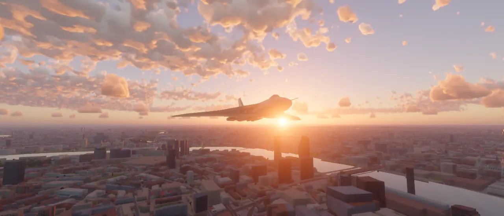
</p>

<h1 align="center">Skyward</h1>

<p align="center">
  <strong>An open-source flight simulator over the real world.</strong><br>
  Endless OpenStreetMap scenery, physically based skies, real aircraft with JSBSim aerodynamics,<br>
  live weather, ILS approaches, ATC on the radio. Native Rust on wgpu, and it runs in your browser too.
</p>

<p align="center">
  <a href="https://github.com/WillMatthews/skyward/actions/workflows/ci.yml"></a>
  <a href="LICENSE"></a>
  <a href="https://www.rust-lang.org/"></a>
  
  <a href="https://github.com/gfx-rs/wgpu"></a>
</p>

<p align="center">
  <a href="https://willmatthews.github.io/skyward/"></a>
  &nbsp;
  <a href="#quick-start"></a>
</p>

<p align="center"><sub>
  The browser version needs a WebGPU browser (recent Chrome or Edge; see <a href="#browser-version">Browser version</a>).
  The native desktop build is the full-quality version.
</sub></p>

<p align="center">
  <a href="#gallery">Gallery</a> ·
  <a href="#features">Features</a> ·
  <a href="#aircraft">Aircraft</a> ·
  <a href="#quick-start">Quick start</a> ·
  <a href="#controls">Controls</a> ·
  <a href="#multiplayer">Multiplayer</a> ·
  <a href="#architecture">Architecture</a> ·
  <a href="#credits-and-licences">Credits</a>
</p>


## Gallery

Every picture is a straight capture from the sim's headless renderer (`skyward --shot`). Nothing is
painted over or composited.

<table>
  <tr>
    <td width="33%" valign="top"><a href="docs/media/gallery/cockpit-a320.jpg">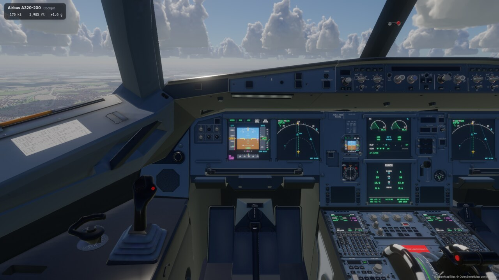</a><br><sub><b>Live glass.</b> A320 on finals to Heathrow.</sub></td>
    <td width="33%" valign="top"><a href="docs/media/gallery/ils-pfd-nd.jpg">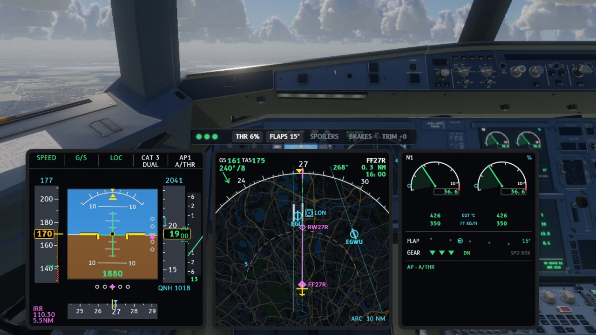</a><br><sub><b>ILS and autoland.</b> LOC and G/S captured.</sub></td>
    <td width="33%" valign="top"><a href="docs/media/gallery/cockpit-c172.jpg">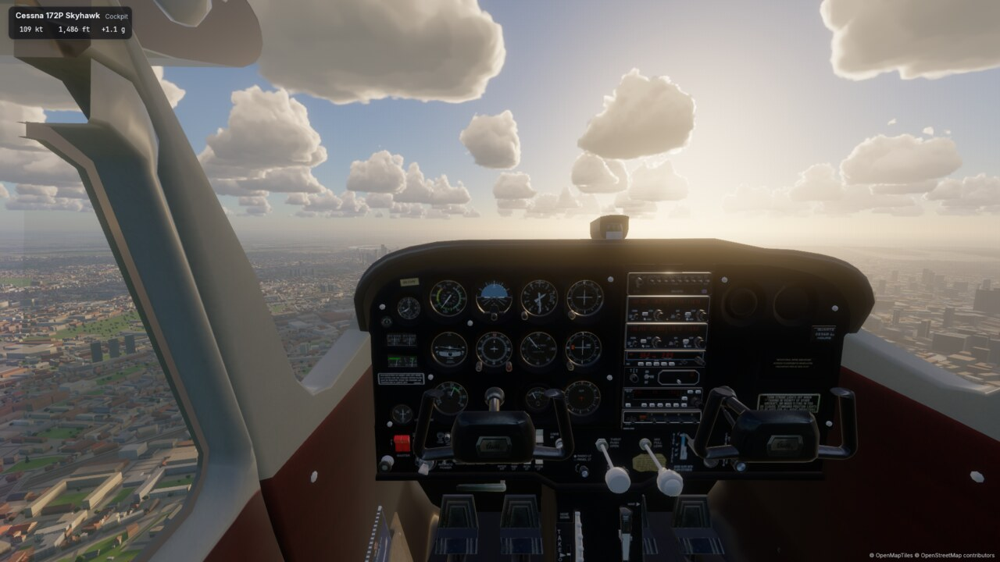</a><br><sub><b>Steam gauges.</b> Cessna 172P, golden hour.</sub></td>
  </tr>
  <tr>
    <td valign="top"><a href="docs/media/gallery/heathrow.jpg">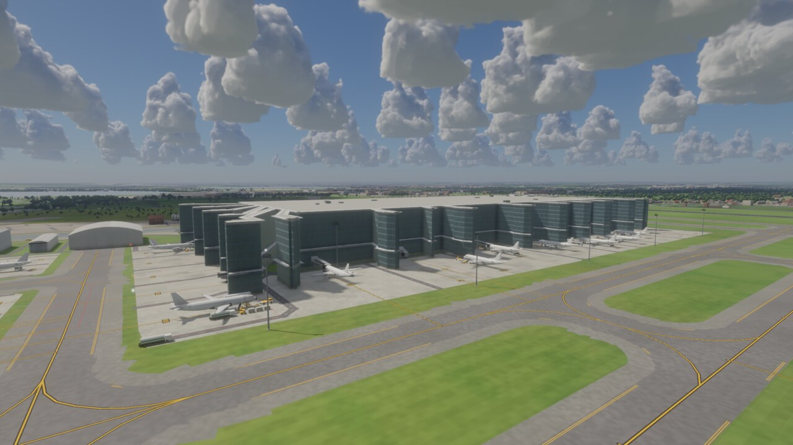</a><br><sub><b>Real airports.</b> Heathrow T5 stands.</sub></td>
    <td valign="top"><a href="docs/media/gallery/london-night.jpg">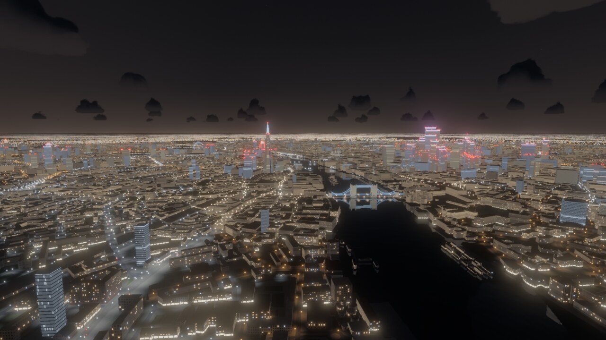</a><br><sub><b>Night.</b> Tower Bridge and the City.</sub></td>
    <td valign="top"><a href="docs/media/gallery/clouds-glider.jpg">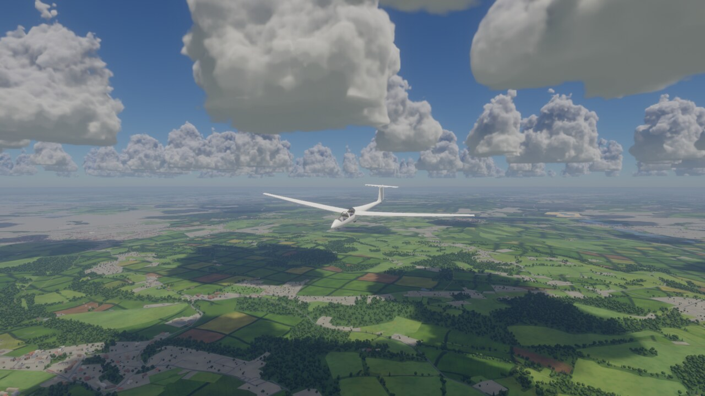</a><br><sub><b>Volumetric clouds.</b> ASK 21 under cumulus.</sub></td>
  </tr>
  <tr>
    <td valign="top"><a href="docs/media/gallery/alps-innsbruck.jpg">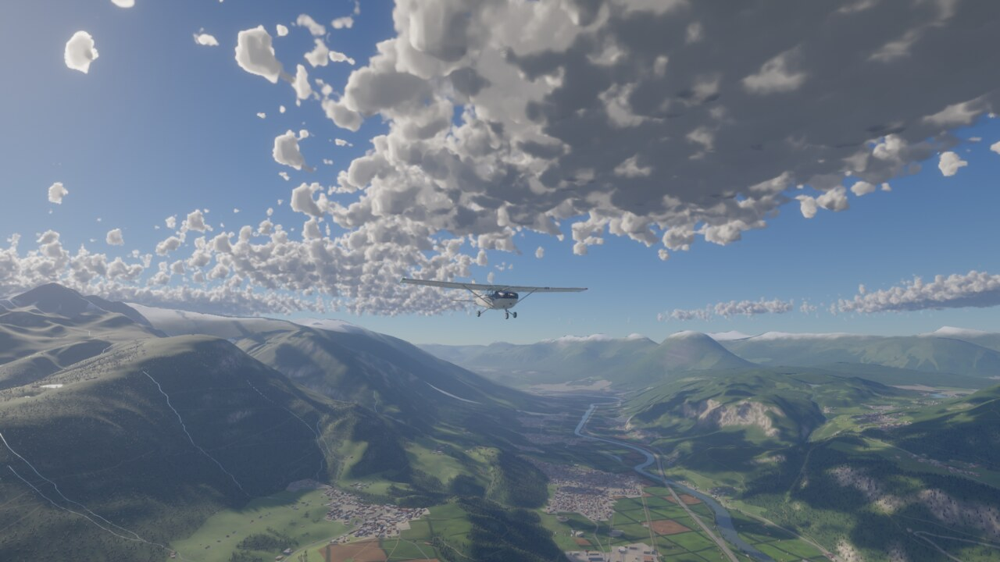</a><br><sub><b>Terrain.</b> The Inn valley at Innsbruck.</sub></td>
    <td valign="top"><a href="docs/media/gallery/vapour-cone.jpg">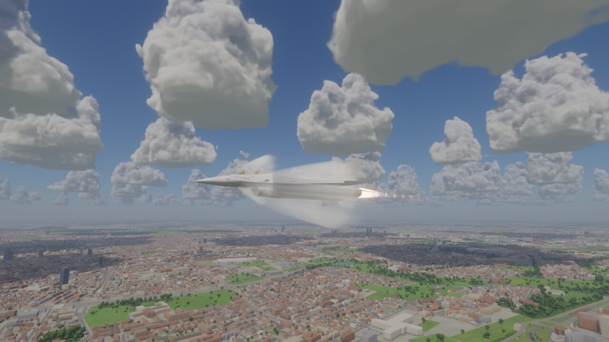</a><br><sub><b>VFX.</b> F-16 vapour cone, Mach 0.98.</sub></td>
    <td valign="top"><a href="docs/media/gallery/rotor-wash.jpg">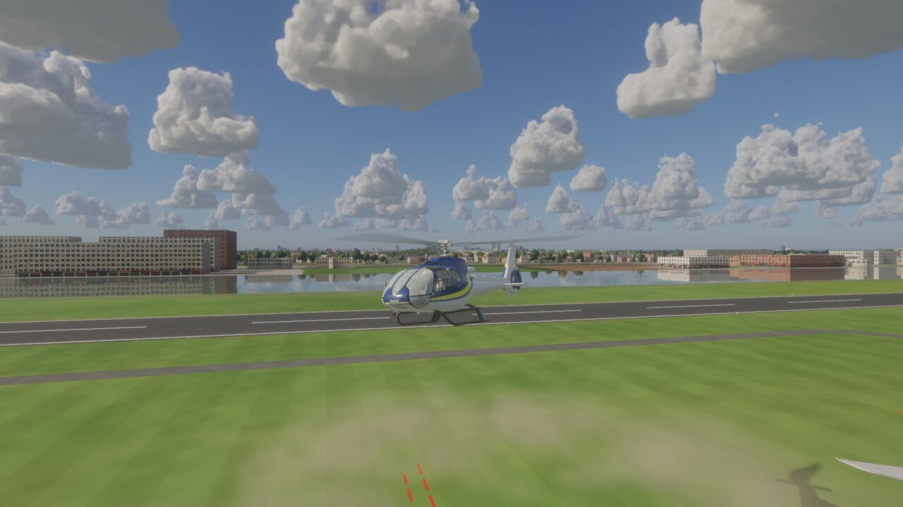</a><br><sub><b>Rotorcraft.</b> EC130 rotor wash.</sub></td>
  </tr>
  <tr>
    <td valign="top"><a href="docs/media/gallery/fpv-osd.jpg">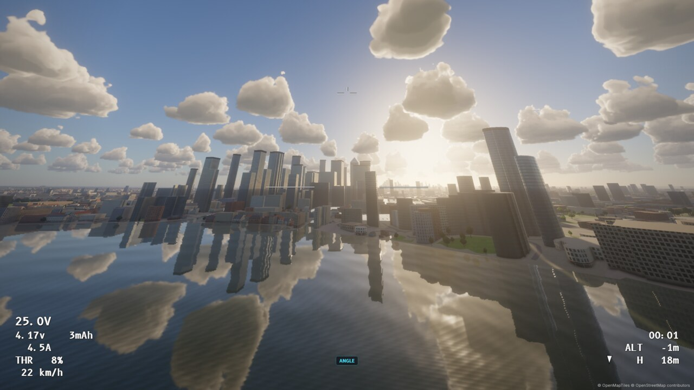</a><br><sub><b>FPV drone.</b> Canary Wharf, quad camera.</sub></td>
    <td valign="top"><a href="docs/media/gallery/failures-ecam.jpg">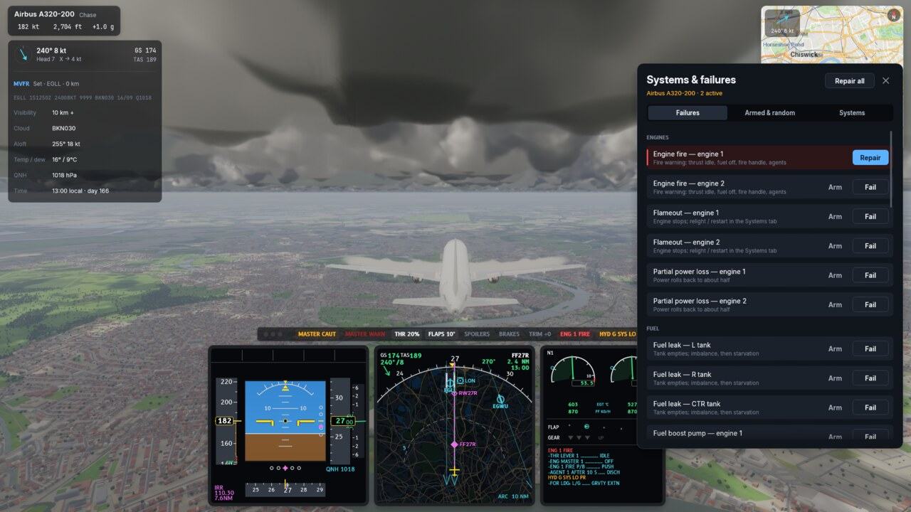</a><br><sub><b>Failures.</b> Engine fire, ECAM.</sub></td>
    <td valign="top"><a href="docs/media/gallery/crash-vfx.jpg">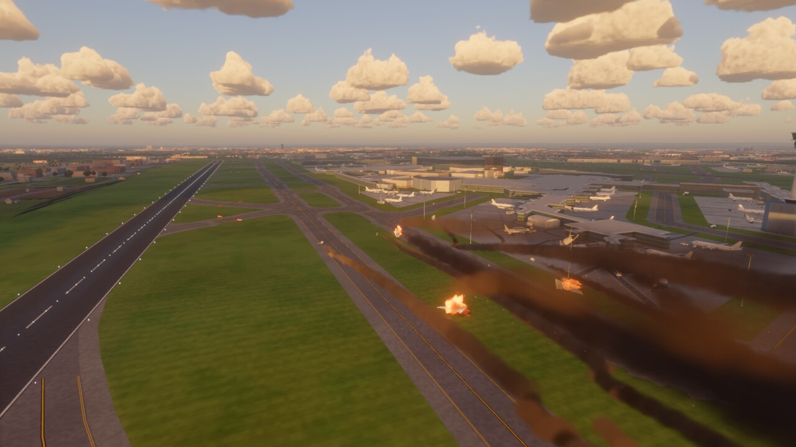</a><br><sub><b>Crashes.</b> Debris, fire, smoke.</sub></td>
  </tr>
</table>

## Features

### The world

- **Anywhere on Earth, endlessly.** OpenMapTiles vector tiles from OpenFreeMap (no API key) stream in
  around you: extruded buildings with facades and lit windows, trees, roads, rivers, parks and
  airfields out to ~7.5 km, a generalised far field to ~30 km, terrain to ~95 km.
- **Real terrain.** DEM elevation (AWS Terrain Tiles) under every level of detail, with map layers
  draped exactly onto it, levelled lakes and runways, ridge shadows, rock and a seasonal snow line.
- **Landmarks.** Procedural models built to real dimensions replace the OSM boxes: the Shard, Tower
  Bridge, the London Eye (its wheel turns), St Paul's, Big Ben, the Gherkin, Battersea and more.
  Floodlit at night.
- **~49,000 airports** from OurAirports, each detailed from map data, Overpass and procedural fill:
  markings, holding points, terminals, hangars, towers, jet bridges, parked aircraft, driving
  ground vehicles, windsocks in the real wind, lit signs, taxiway lights and stop bars.
- **Road traffic.** Cars, vans, buses, lorries and motorbikes drive the real road network: lanes on
  the painted lane lines, one-way streets, keep-left or keep-right by country, give-way at junctions,
  queues, rush hours and quiet nights, red double-deckers and black cabs in London. Head, tail and
  brake lights at night. Off / Low / Medium / High in Settings › Display.
- **Fly as far as you like.** A floating origin re-centres the world as you fly, so London to Paris
  and beyond stays precise and hitch-free.

### Rendering

- **Physically based sky.** Hillaire-style atmosphere with aerial perspective, AgX tonemapping,
  bloom, cascaded shadows, SSAO, planar water reflections and MSAA HDR.
- **Volumetric clouds.** Ray-marched cumulus, stratus and cirrus with temporal reprojection and
  cloud shadows on the ground.
- **Weather and seasons.** Rain, snow, fog and wet ground; leaf fall, autumn colours and crop
  calendars.
- **Thunderstorms.** Cumulonimbus towers with anvils, overshooting tops and dark bases, driven by
  the METAR (TS, CB, TCU, +TSRA, VCTS, GR) and the forecast's CAPE; rain shafts and virga under
  them, visible from far away; lightning that lights the cloud from inside, branching
  cloud-to-ground bolts, a flash over the whole scene and thunder arriving distance / c later.
  Lenticular clouds stack over mountain waves.
- **On the glass.** Rain drops on the windscreen that refract the view and run with the airflow,
  wipers on the airliners (off / slow / fast / auto), misting, frost creeping in from the frame,
  and rime ice on the leading edges as airframe icing builds.
- **Night.** Moon and stars, skyglow, street lights, lit windows, moving traffic, airport lighting,
  PAPIs and landing lights.
- **Effects.** Transonic vapour cones, afterburner shock diamonds, heat haze, Schmidt–Appleman
  contrails, wingtip vortices, rotor wash, fireballs, fuel fires, smoke, dust and spray.

### Flight

- **One 6-DoF flight model for fixed wings.** It covers the ISA atmosphere, engines and propellers,
  gear, spoilers, reversers, asymmetric thrust and FBW control laws. **JSBSim aerodynamics** are
  evaluated at run time for the types that ship JSBSim data.
- **Skyward's own rotorcraft model.** Blade-element and momentum main rotor with rotor RPM, a FADEC
  turboshaft, Fenestron, translational lift, ground effect, vortex ring state, retreating-blade
  stall, dynamic rollover and **autorotation** to a flared landing.
- **Structure and crashes.** Wings flex with load. There are limit and ultimate load factors,
  flutter and overspeeds, and parts that tear off and change the aerodynamics. Survivable accidents
  slide to a stop; fatal ones break into rigid-body debris that tumbles, burns and sinks.
- **Ground handling.** Every wheel has a tyre model: slip ratio with the wheel's spin (spin-up
  smoke at touchdown, locked-wheel skids, anti-skid), slip angle and the friction ellipse, oleo
  struts, rolling resistance. Friction depends on the surface and the weather: dry / wet /
  flooded asphalt and concrete, grass, gravel, dirt, slush, snow and ice, with **hydroplaning**
  above 9·√p kt. Steel and carbon brakes heat up, fade, show on the ECAM / EICAS WHEEL page and
  melt their fusible plugs. Autobrake LO / MED / MAX / RTO, parking brake, chocks, ground power,
  **nose-wheel tillers** (pedals steer only a few degrees), castering nose wheels and tail wheels
  with differential braking, a lockable DC-3 tail wheel — and real ground loops in taildraggers.
  **Pushback** by a tug (straight, tail left / right), **taxi guidance** with
  **follow-the-greens** centreline lights and the route on the moving map, and an auto-flight
  bot that pushes back and taxis the taxiway network to the holding point and back to a stand.
- **Live weather and wind.** The nearest METAR plus Open-Meteo drive clouds, visibility,
  precipitation, the wind gradient and winds aloft up to the jet, gusts and drifting thermals.
  Real local time and date, re-fetched along long flights.
- **Turbulence that feels real.** The Dryden model of MIL-F-8785C as a frozen 3D field (low,
  medium and high-altitude intensities and scale lengths; light to extreme) with rotational gusts
  across the span; convective bumps under cumulus, severe turbulence and drafts in thunderstorms
  and their gust fronts, clear-air turbulence in the jet's wind shear, mountain waves and rotors in
  the lee of ridges, and wake vortices behind multiplayer players and live ADS-B traffic (and your own, after a steep 360). Cockpit head motion and
  seat-of-the-pants thumps; Realistic / Reduced / Off in Settings › Weather & Time.
- **Weather radar.** The airliners' ND shows the storms' returns (green / yellow / red / magenta),
  with tilt, gain and the radar shadow behind heavy rain.

### Systems, navigation and ATC

- **Systems per type.** Electrics, fuel (burn feeds mass and CG), hydraulics, vacuum and
  pitot-static, engine starts from cold and dark, APU, anti-ice and icing.
- **Failures.** 24 failures behave like the real ones: fires, flameouts, a pitot blockage that turns
  the ASI into an altimeter, toppling gyros, gear that needs the alternate extension, tyre bursts,
  bird strikes. Each brings master warning or caution, an ECAM / EICAS procedure that ticks off as
  you fly it, and the aural alerts. Fail anything now, arm it, or set random failures by MTBF.
- **Navigation.** VOR, DME and NDB from OurAirports, plus an ILS for every instrument runway. NAV,
  COM and ADF radios have range, radio horizon and terrain line of sight, and Morse idents. There is
  an FMS-lite flight plan with an MCDU page, and PFD and ND in ROSE / ARC / PLAN.
- **Autopilot and autoland.** HDG, ALT, V/S, SPD, LOC, VOR, LNAV, VNAV and APPR with no-overshoot
  captures. The airliners flare, retard and roll out on the localizer.
- **ATC and ATIS on the radio.** Each airport's real frequencies. UK CAP 413 phraseology in six
  synthesised voices, played through an AM airband chain with subtitles. ATIS reads the live METAR.
  ATC covers clearance, taxi routing over the taxiway graph, take-off, radar vectors to the ILS,
  landing and taxi-in, and reacts to level busts, incursions and MAYDAYs.

### Everything else

- **Emergency missions.** Twelve airline emergencies, fictional but inspired by real incidents. You fly each one through to a safe outcome:
  a V1 engine fire, rapid decompression, a belly landing, unreliable airspeed at night, a microburst on final, an uncontained engine failure,
  a dual bird strike over the Thames (land or ditch), smoke with a clock running, jammed flaps in a crosswind, a fuel-exhaustion glide and
  thrust-only control. Each has a briefing, live objectives, cabin PA, fire tenders and a scored debrief with medals.
- **Multiplayer.** A shared sky on your LAN: a headless dedicated server, a server browser that finds
  it by itself, everyone's real models, lights and engine sound, name tags, traffic on the map and
  TCAS on the ND, chat, a quick-chat wheel and spectating. Time and weather come from the server.
- **Dogfights.** The Spitfire IX (2 × 20 mm Hispano + 4 × .303) and the F-16C (M61A1, AIM-9M,
  AIM-120C, flares, chaff, radar and RWR) fire real ballistics: Mach-dependent drag, gravity,
  dispersion and tracers. Missiles fly proportional navigation with IR or radar seekers that flares,
  chaff, the sun and the Doppler notch can fool. Hits land on per-part hit volumes cut from the real
  model and drive the structure and systems simulations: spars weaken, wings and tails tear off, the
  engine loses power, catches fire or seizes when the glycol runs out, and tanks leak or burn. The
  pilot can be wounded or killed, or can eject (ACES II) or bail out under a parachute. AI opponents
  from rookie to ace fly the same flight model with BFM. Quick-start 1v1 or 2v2 from the main menu.
  The HUD has a gun funnel and LCOS, seeker and ASE circles and launch zones; the Spitfire has a Mk II
  gyro gunsight; the F-16 has an RWR with tones. Fights work in multiplayer too: hits are
  claimed by the shooter, checked by the server and applied by the target (`--combat on|off` on the server).
- **Sound.** Real FlightGear engine recordings mixed with Skyward's own synthesis: prop blade-pass,
  afterburner crackle, positional / Doppler mixing, sonic-boom N-waves, GPWS callouts, impacts.
- **Instruments.** Full 3D cockpits with live needles and glass displays, a 2D glass or steam-gauge
  overlay per class, a conformal HUD in the fighter, and a vector moving map with day, night and ND
  styles.
- **Input devices.** Gamepads, joysticks and HOTAS, throttle quadrants and rudder pedals, all at
  once and hot-pluggable. Curves, deadzones, calibration, rebinding, mouse yoke and head-look.
- **Watch mode.** An AI pilot flies the real flight model through the controls: take-off,
  sightseeing tour, approach and landing, wind-aware, doing its own radio calls. The glider bot
  thermals under cumulus. Add the cinematic camera and leave it running.
- **Menus.** Aircraft cards, a world-map airport picker with fuzzy search that zooms smoothly from
  the whole globe down to a single stand (day / night map styles, runways to scale, full airport
  diagrams with stands, holding points and helipads; click a runway end, stand or helipad to start
  there), live crosswind, and conditions from live to any METAR.
- **Settings.** Fourteen categories with search across all of them, Apply / Revert, realism presets,
  assists, camera and units options, and colour-blind and high-contrast palettes. Every screen works
  with a keyboard or a game controller, at interface scales from 80 to 200 %.

## Aircraft

Twenty-one flyable types. The FlightGear models, cockpits and flight-dynamics data are GPL, credited per
aircraft in [`assets/aircraft/<id>/CREDITS.md`](assets/aircraft) and rebuilt by
[`tools/fgimport/`](tools/fgimport).

<table>
  <tr>
    <td width="190" valign="top">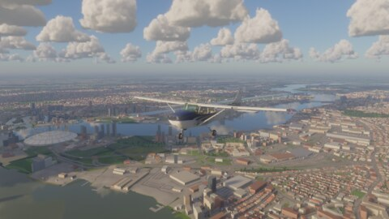</td>
    <td valign="top"><b>Cessna 172P Skyhawk</b><br><code>kestrel</code> <sub>(<code>c172</code>)</sub><br><sub><i>JSBSim flight model</i></sub><br><sub>The trainer. KAP 140 autopilot, 3D radios and steam gauges.</sub></td>
    <td width="190" valign="top">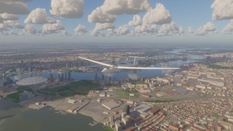</td>
    <td valign="top"><b>Schleicher ASK 21</b><br><code>swift</code> <sub>(<code>ask21</code>)</sub><br><sub><i>JSBSim flight model</i></sub><br><sub>Two-seat sailplane. TE vario with MacCready ring; released near a thermal.</sub></td>
  </tr>
  <tr>
    <td width="190" valign="top">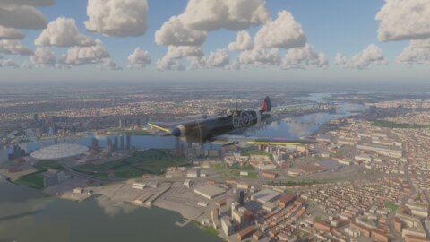</td>
    <td valign="top"><b>Supermarine Spitfire Mk IX</b><br><code>peregrine</code> <sub>(<code>spitfire</code>)</sub><br><sub><i>Calibrated flight model</i></sub><br><sub>Merlin warbird. Swings on take-off, torque, P-factor.</sub></td>
    <td width="190" valign="top">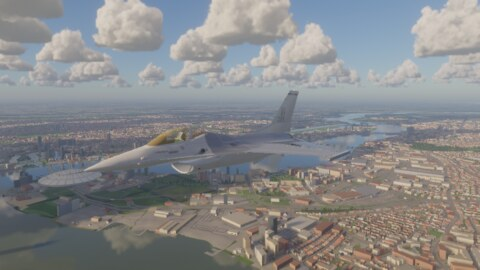</td>
    <td valign="top"><b>General Dynamics F-16C</b><br><code>lancer</code> <sub>(<code>f16</code>)</sub><br><sub><i>JSBSim flight model</i></sub><br><sub>FBW fighter with afterburner, conformal HUD, supersonic.</sub></td>
  </tr>
  <tr>
    <td width="190" valign="top">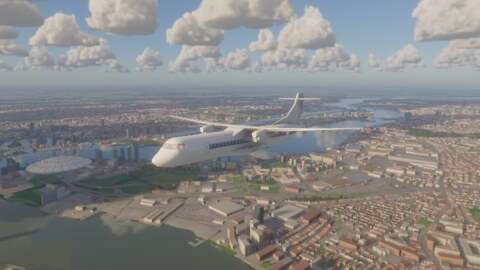</td>
    <td valign="top"><b>ATR 72-500</b><br><code>aerolink</code> <sub>(<code>atr72</code>)</sub><br><sub><i>Calibrated flight model</i></sub><br><sub>Twin-turboprop regional airliner, reverse pitch.</sub></td>
    <td width="190" valign="top">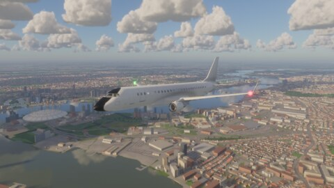</td>
    <td valign="top"><b>Embraer E190</b><br><code>meridian190</code> <sub>(<code>e190</code>)</sub><br><sub><i>JSBSim flight model</i></sub><br><sub>Regional jet, autoland.</sub></td>
  </tr>
  <tr>
    <td width="190" valign="top">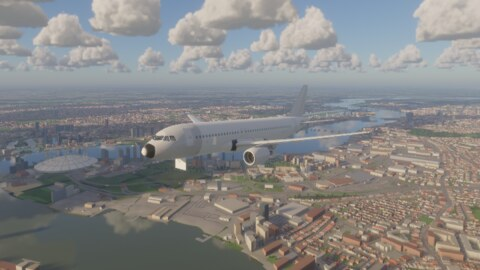</td>
    <td valign="top"><b>Airbus A320-200</b><br><code>meridian320</code> <sub>(<code>a320</code>)</sub><br><sub><i>JSBSim flight model</i></sub><br><sub>Normal-law FBW, live PFD / ND / ECAM / MCDU, autoland.</sub></td>
    <td width="190" valign="top">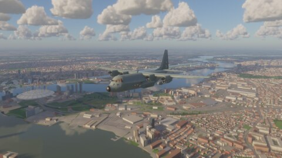</td>
    <td valign="top"><b>Lockheed C-130H Hercules</b><br><code>hercules</code> <sub>(<code>c130</code>)</sub><br><sub><i>Calibrated flight model</i></sub><br><sub>Four T56s, short and rough fields (grass OK), cargo ramp.</sub></td>
  </tr>
  <tr>
    <td width="190" valign="top">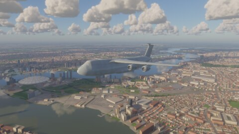</td>
    <td valign="top"><b>Lockheed C-5M Super Galaxy</b><br><code>galaxy</code> <sub>(<code>c5</code>)</sub><br><sub><i>JSBSim + patches flight model</i></sub><br><sub>280 t airlifter. Slow-spooling CF6s, huge inertia.</sub></td>
    <td width="190" valign="top">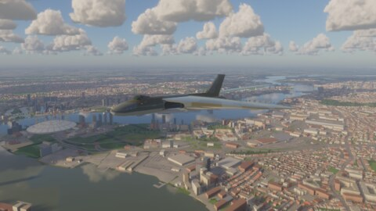</td>
    <td valign="top"><b>Avro Vulcan B.2</b><br><code>vulcan</code><br><sub><i>JSBSim + delta aero flight model</i></sub><br><sub>No stall break, big high-alpha drag, the Olympus howl.</sub></td>
  </tr>
  <tr>
    <td width="190" valign="top">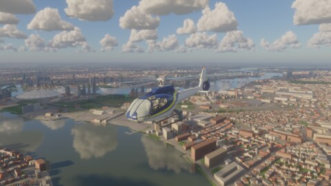</td>
    <td valign="top"><b>Airbus Helicopters EC130 B4</b><br><code>ec130</code> <sub>(<code>heli</code>)</sub><br><sub><i>Skyward rotor flight model</i></sub><br><sub>Collective, cyclic, pedals. VEMD, autorotation, stability assist.</sub></td>
    <td width="190" valign="top">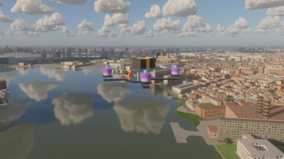</td>
    <td valign="top"><b>5″ FPV quadcopter</b><br><code>fpv</code> <sub>(<code>quad</code>, <code>drone</code>)</sub><br><sub><i>Skyward quad flight model</i></sub><br><sub>Acro / angle modes, Betaflight-style rates, 6S sag, OSD.</sub></td>
  </tr>
  <tr>
    <td width="190" valign="top">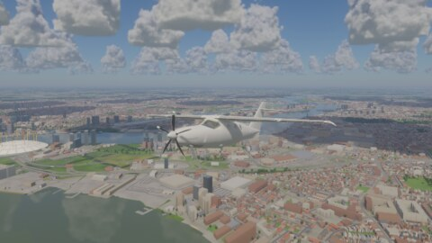</td>
    <td valign="top"><b>Extra EA-500</b><br><code>extra500</code> <sub>(<code>ea500</code>)</sub><br><sub><i>Calibrated flight model</i></sub><br><sub>Six-seat turboprop tourer with glass IFDs.</sub></td>
    <td width="190" valign="top">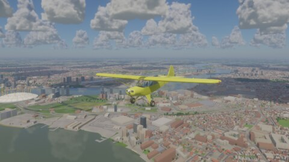</td>
    <td valign="top"><b>Piper PA-18 Super Cub</b><br><code>cub</code> <sub>(<code>pa18</code>)</sub><br><sub><i>Calibrated flight model</i></sub><br><sub>Tube-and-fabric bush taildragger.</sub></td>
  </tr>
  <tr>
    <td width="190" valign="top">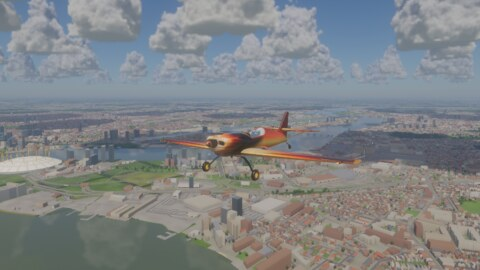</td>
    <td valign="top"><b>Zlin Z-50 LX</b><br><code>zlin</code> <sub>(<code>z50</code>)</sub><br><sub><i>Calibrated flight model</i></sub><br><sub>Unlimited aerobat: snap rolls, spins, inverted systems, airshow smoke.</sub></td>
    <td width="190" valign="top">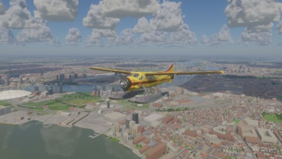</td>
    <td valign="top"><b>DHC-3 Otter (floats)</b><br><code>otter</code> <sub>(<code>dhc3</code>, <code>floatplane</code>)</sub><br><sub><i>Calibrated flight model</i></sub><br><sub>Radial bush plane on floats: planing, step, water rudders; starts on the water.</sub></td>
  </tr>
  <tr>
    <td width="190" valign="top">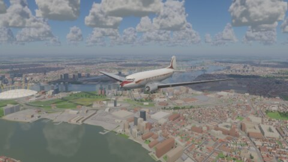</td>
    <td valign="top"><b>Douglas DC-3 / C-47</b><br><code>dc3</code> <sub>(<code>dc-3</code>)</sub><br><sub><i>Calibrated flight model</i></sub><br><sub>The classic twin-radial airliner, tail-wheel handling.</sub></td>
    <td width="190" valign="top">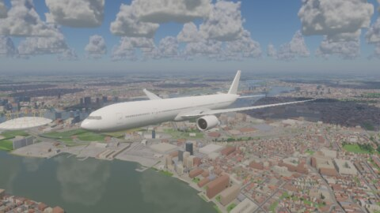</td>
    <td valign="top"><b>Boeing 777-300ER</b><br><code>triple7</code> <sub>(<code>777</code>)</sub><br><sub><i>Calibrated flight model</i></sub><br><sub>Widebody twin, 513 kN GE90s, FBW, live PFD / ND / EICAS / MFD / CDUs.</sub></td>
  </tr>
  <tr>
    <td width="190" valign="top">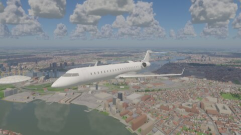</td>
    <td valign="top"><b>Bombardier CRJ700</b><br><code>crj700</code> <sub>(<code>crj</code>)</sub><br><sub><i>JSBSim + patches flight model</i></sub><br><sub>Regional jet: rear-mounted CF34s, T-tail, live glass displays.</sub></td>
    <td width="190" valign="top">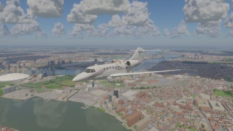</td>
    <td valign="top"><b>Cessna Citation X</b><br><code>citationx</code> <sub>(<code>citation</code>)</sub><br><sub><i>Calibrated flight model</i></sub><br><sub>Mach 0.92 business jet with its live Primus 2000 panel.</sub></td>
  </tr>
  <tr>
    <td width="190" valign="top">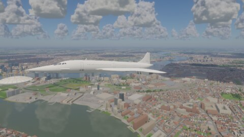</td>
    <td valign="top"><b>Aerospatiale/BAC Concorde</b><br><code>concorde</code> <sub>(<code>sst</code>)</sub><br><sub><i>JSBSim + delta aero flight model</i></sub><br><sub>Mach 2 at FL550, reheat, vortex lift, trim-fuel CG transfer, droop nose / visor, live analogue cockpit.</sub></td>
  </tr>
</table>

<sub>"Calibrated" = Skyward's parametric model tuned to the package's YASim data and published
figures. The FPV quad's model is Skyward's own; every other model is a FlightGear aircraft with a
neutral livery.</sub>

## Quick start

**Prerequisites:** Rust **1.98+** ([rustup](https://rustup.rs/)) and a GPU with Vulkan. On Linux,
also the ALSA and udev headers:

```sh
# Debian / Ubuntu
sudo apt install pkg-config libasound2-dev libudev-dev
# Fedora
sudo dnf install pkgconf-pkg-config alsa-lib-devel systemd-devel
```

**Build and fly:**

```sh
git clone https://github.com/WillMatthews/skyward
cd skyward
cargo run --release
```

The first run downloads map tiles, terrain and the airport list into `cache/`; after that it works
from the cache. On hybrid-graphics laptops Skyward asks for the high-performance GPU.

> [!NOTE]
> Linux is the primary, CI-tested platform. The stack (wgpu, winit, cpal, gilrs) is cross-platform,
> so Windows (DX12 / Vulkan) and macOS (Metal) builds should work, but they aren't tested in CI yet.
> Reports and fixes are welcome.

**A few ways in:**

```sh
cargo run --release -- --airport EGLL                     # any ICAO / IATA / name
cargo run --release -- --airport EGKK --aircraft a320 --start-at final:26L:5 --no-menu
cargo run --release -- --airport LOWI --aircraft c172     # Innsbruck, in the Alps
cargo run --release -- --watch --aircraft vulcan          # sit back: AI pilot + cinematic camera
cargo run --release -- --aircraft f16 --dogfight 2v2 --difficulty ace --no-menu   # guns, missiles, AI wingman
```

### Browser version

The same code builds for the web (wasm32 + **WebGPU**). It has menus, every aircraft, streamed
scenery, terrain, live weather and sound in a tab.
**Play it at [willmatthews.github.io/skyward](https://willmatthews.github.io/skyward/)**.

<details>
<summary><b>Browser requirements, differences and building it locally</b></summary>

- **Browsers.** WebGPU is required: Chrome / Edge 113+ (Windows, macOS, ChromeOS, Android; on Linux
  behind `chrome://flags/#enable-unsafe-webgpu`), Safari 26+, or Firefox 141+ on Windows. Without it
  the page says so.
- **Download.** ≈15 MB of wasm (≈9 MB gzipped) before the first flight, then the chosen aircraft
  (2–15 MB) and the airport list (≈4 MB compressed, once per browser cache). Map, terrain and weather
  stream as on the desktop; the browser's HTTP cache stands in for `cache/`.
- **Differences from native.**
  - No live METARs: aviationweather.gov sends no CORS headers, so weather comes from Open-Meteo.
  - Settings are kept in `localStorage`.
  - Lighter defaults: low scenery detail, 2048² shadow cascades, and the 3D view drawn at
    ≤ 1.6 Mpixel and scaled up.
  - Sound starts after you click Fly.
  - No multiplayer: browsers cannot send the UDP packets the game and LAN discovery use.
  - No aircraft-card thumbnails and no Quit button.
  - Tiles are built in Web Workers (`src/tiles_web.rs`).
- **URL options.** The query string is the command line, e.g.
  `?airport=EGKK&aircraft=meridian320&no-menu`, `?watch`, `?time=12.00`. `?scale=0.5` renders the 3D
  view at half size; `?noworkers` builds tiles on the page.

Build and serve locally (127.0.0.1 only):

```sh
rustup target add wasm32-unknown-unknown
cargo install wasm-bindgen-cli --version 0.2.130 --locked   # = Cargo.lock's wasm-bindgen
cargo install wasm-opt --locked                              # optional (smaller, faster wasm)
scripts/web-serve.sh            # build dist/ and serve http://127.0.0.1:8098/
scripts/web-build.sh            # build dist/ only
```

[`.github/workflows/pages.yml`](.github/workflows/pages.yml) builds `dist/` on pushes to `main` and
deploys it to GitHub Pages.

</details>

## Controls

Every key can be rebound in **Settings › Controls**. Press **H** or **F1** in flight for help.

| Key | Action | Key | Action |
|---|---|---|---|
| **W S / ↑ ↓** | Pitch | **G** | Gear |
| **A D / ← →** | Roll | **F / V** | Flaps (glider: airbrakes) |
| **Q E** | Rudder / steer | **B** or **Space** | Brakes |
| **Shift / Ctrl** | Throttle | **Z** | Autopilot on / off |
| **C** | Camera: chase, cockpit, tower, fly-by, cinematic | **2** | APPR: ILS capture and autoland |
| **Right-drag, wheel** | Look / orbit, zoom | **J** | Hand over to the AI pilot |
| **M** | Moving map | **F3** / **F4** | Radios & flight plan / ATC comms |
| **Space** (armed, in the air) | Fire | **F5 / F7 / F8** | Weapon · lock · flares |
| **Esc** | Pause menu | **O** / **F2** | Systems & failures |
| **Right Alt** | Parking brake (on the ground) | **Left Alt** | Ground menu: pushback, chocks, autobrake, taxi guidance |

<details>
<summary><b>Full keyboard reference</b></summary>

| Key | Action |
|---|---|
| ↑ / W, ↓ / S | pitch down / up |
| ← / A, → / D | roll |
| Q / E | rudder (steers on the ground) |
| Shift / Ctrl, = / -, PgUp / PgDn | throttle (Lancer: above the 90 % detent = afterburner) |
| F / V | flaps (glider: airbrakes) out / in |
| G | landing gear up / down (3 green = down and locked, red = in transit) |
| / and \ (or ') | spoilers / speed brake out / in one step |
| T | thrust reverse on / off (ground only; throttle then sets reverse power) |
| B or Space (hold) | brakes (single-lever types split them with the rudder) |
| Right Alt | parking brake set / release (on the ground; in the air it is weapon release on armed types) |
| Left Alt | **ground menu** (the comms panel's Ground page; 1–9 pick): push back straight / tail left / tail right (stop during the push; set the parking brake when told and the tug disconnects), parking brake, chocks + ground power, autobrake OFF → LO → MED → MAX (Embraer: RTO too; pedal braking or thrust disarms it), DC-3 tail-wheel lock, taxi guidance (route to the departure holding point — or after a flight a free stand — on the moving map, follow-the-greens lights, next turn and speed). Also on F4 › Ground crew & taxi |
| (unbound) | toe brakes left / right, nose-wheel tiller left / right, and each ground-menu action as its own key: bind them in Settings › Controls › Ground. Without a tiller the rudder keys work it below ~30 kt; with B or Space the rudder splits the brakes on light types |
| [ / ] | trim nose down / up |
| Z | autopilot on (holds heading, altitude, speed) / off; a mouse AP panel appears |
| Ins / Del, Home / End, 9 / 0 | autopilot heading ∓5°, altitude ±100 ft, speed ∓5 kt |
| 1 / 2 / 3 / 4 | autopilot LOC (VOR) track on NAV 1 / **APPR** (LOC + G/S, autoland on airliners) / LNAV (flight plan) / VNAV; arm, press again to cancel |
| 5, 6 / 7, 8 | NAV 1: swap active ↔ standby, course (OBS) −/+ 1°, Morse ident audio |
| F3 | **radios & flight plan** panel: COM / NAV / ADF frequencies, course, ident, transponder; route, destination + approach, direct-to, predictions |
| F5 / F7–F10 | **split throttles**: F7/F8 left engines −/+, F9/F10 right engines −/+, F5 brings the levers back together |
| F4 | **ATC comms menu**: the requests for the unit on COM 1 (1–9 pick, 0 = tune a station, Esc closes), read-back / assist / subtitle / COM 2 options |
| Space (in the air) | **weapons** (Spitfire, F-16): fire the selected weapon — guns (held), a missile in SRM / MRM (press); still the wheel brakes on the ground |
| Right Alt | Spitfire: cannon only (the second button); F-16: weapon release (pickle) — in the air (on the ground it is the parking brake) |
| F5 / F7 / F8 / F9 | armed single-engine types: master mode GUN → SRM → MRM (Spitfire: cannon + MG / cannon / MG), radar lock / AIM-9 uncage, flares + chaff, gun harmonisation range |
| F10 twice | eject (F-16 ACES II) / bail out (Spitfire) |
| ; | navigation display: ROSE ILS → ROSE VOR → ROSE NAV → ARC → PLAN |
| K | engine-failure practice (fails engine 1, then 2, then restores) |
| O / F2 | **systems & failures** panel: fail / arm / random failures, repair; systems (battery, generators, fuel, engine start, APU, hydraulics, anti-ice, alternate gear, fire handles) |
| ` | master warning / caution reset (silences the chime) |
| J | **auto flight**: the bot flies; any stick / throttle / lever input takes back |
| C | camera: chase → cockpit → tower → fly-by → cinematic |
| Right-drag, wheel | orbit / zoom chase camera; in the cockpit: look around |
| Num 4 / 6 / 8 / 2, Num 5 | glance left / right / up / down (hold), centre the view |
| Y | mouse yoke on / off (enable it in Settings › Controls › Mouse & view) |
| M, `,` / `.` | moving map: corner / large / off, range out / in |
| U | instruments: full / minimal / off |
| I | weather panel: expand / collapse |
| Caps Lock | windscreen wipers: off → slow → fast → auto (airliners) |
| Num / | weather radar tilt: auto → +2° → 0° → −1.5° → −3° → −5° (airliners; weapon release on armed types; gain: bind *Weather radar gain* in Settings › Controls) |
| N | mute sound |
| X | time warp 1 / 2 / 4 / 8× |
| P | pause |
| R | restart (back at the start point) |
| Esc / Tab | pause menu: resume, restart, change aircraft / airport, settings |
| H / F1 | help |
| F12 | screenshot |
| Enter, F11, Num *, Backspace / Num 0 | multiplayer (when connected): chat, players & spectate, name tags, quick-chat wheel; Num * also toggles the live-traffic tags |

Stick inputs disconnect the autopilot (flashing AP DISCONNECT); throttle keys only drop the
autothrottle.

**Helicopter (EC130):** collective on the throttle, cyclic on the stick, pedals on the rudder;
G or F6 cycles the stability assist (attitude hold → off → SAS); K fails the engine (autorotation).
**FPV quad:** G or `;` switches angle / rate (acro) mode; C → cockpit is the FPV camera with OSD; on
a gamepad both sticks fly "mode 2".

</details>

<details>
<summary><b>Game controllers, joysticks and pedals</b></summary>

Gamepads, joysticks / HOTAS, throttle quadrants and rudder pedals work out of the box and can be
used together (gilrs: Linux evdev, Windows, macOS, browser Gamepad API; on Linux, button-less pedals
are read straight from evdev). Hot-plug is supported. Each device model gets a default layout the
first time it's seen:

- **Xbox / PlayStation pads.** Left stick flies, triggers are rudder, right stick looks, bumpers are
  throttle.
- **Sticks** (T.16000M, X52, Extreme 3D...). Twist is rudder, the slider / Z axis is throttle, the hat
  glances.
- **Throttles** (TCA quadrant, X56). One lever per engine.
- **Pedals.** Rudder plus left / right toe brakes (each brakes its own main wheels). A
  **Nose-wheel tiller** axis can be bound in Settings › Controls (Ground).

Layouts are saved per device in the settings file.

<details>
<summary><b>Settings</b></summary>

Open **Settings** from the main menu or the pause menu (Esc in flight). Categories run down the
left. **Search** (Ctrl F, or /) finds any setting by name, description or keyword across every
category, and key bindings by action name. Each row has a one-line description. A blue dot marks
an unapplied change, and the rail shows which categories have one.

- **Apply** saves your changes. **Revert** drops them. Changes preview live while you are on the
  screen. If you leave with unapplied changes, you are asked whether to apply them.
- **Reset category** and **Reset all** ask first. Reset all keeps your recent and favourite
  airports and your player name.
- Rows marked **Restart** take effect at the next start. Rows marked **Soon** are saved now but do
  nothing until the feature lands.
- Keyboard: ↑ ↓ move, ← → change a value, Enter selects, Tab / Shift+Tab change category, Esc goes
  back. Controller: d-pad, A / B, LB / RB.

| Category | Settings |
|---|---|
| Video | vertical sync, scenery detail (graphics presets come with the graphics update) |
| Display & HUD | instruments, speed / altitude / pressure (hPa · inHg) / temperature (°C · °F) units, map style and orientation, name tags, subtitles, interface scale, colour palette, high contrast |
| Camera | cockpit and outside field of view, head-look speed / invert, cockpit head motion, chase distance and lag, starting view |
| Flight & Realism | realism preset (Casual / Standard / Hard), structural damage and crashes (Realistic / Forgiving / Off), engine damage, G-effects (grey-out, blackout, red-out), random failures (and the failures panel in flight), unlimited fuel, auto-rudder, auto-trim, autobrake |
| Assists | taxi ribbon, landing guidance, on-screen STALL and OVERSPEED cues |
| Weather & Time | default weather (live / fixed), fixed clouds, turbulence, time-acceleration limit |
| Traffic | road traffic, parked aircraft, live (ADS-B) traffic and its radius |
| Sound | mute, output device, mute in background, volumes (master, engines, environment, systems, callouts & cabin PA, ATC radio, interface) |
| Controls | bindings, devices, curves, mouse and head-look (below) |
| Multiplayer | player name, default port, name tags, chat filter |
| Accessibility | interface scale, subtitles, colour palette (deuteranopia, protanopia, tritanopia), high contrast, reduced motion, hold or toggle brakes |
| Interface & Language | language (English for now), interface scale, interface sounds |
| Data & Storage | cache location and size, cache limit, clear map tiles / terrain, offline mode, settings file |
| About | version, graphics adapter, licence, credits |

The colour-blind palettes move the interface's status colours (green, red, amber, cyan, magenta)
to versions that stay distinct for that kind of colour vision. Greys and text are unchanged.
The tests check them with a colour-vision simulation and against WCAG AA text contrast.

Settings are saved in `~/.config/skyward/settings.json`, or in `localStorage` in the browser.
`SKYWARD_CONFIG_DIR` points somewhere else. Older files load with new settings at their defaults,
and keys this version doesn't know are kept. Headless captures:
`--menu-screen settings --settings-category camera [--settings-search fov] [--settings-from pause] [--palette deuteranopia] [--high-contrast]`.

</details>

**Settings › Controls** binds any axis or button when you move or press it. Each axis has a
deadzone, response curve, sensitivity, invert and calibration, with a live response plot. You also
get conflict warnings, per-device enable / reset, mouse yoke and head-look. `skyward --controllers`
lists devices and prints their inputs; `SKYWARD_FAKE_INPUT=xbox,x52,t16000m,tca,pedals` adds virtual
devices for tests.

</details>

<details>
<summary><b>Watch mode: what the AI pilot does</b></summary>

Tick **Auto flight (watch)** in the menu, pass `--watch`, or press **J** in flight. The bot flies
the real flight model through the controls and autopilot. Nothing is scripted or teleported.

- **Glider.** Reads the total-energy vario and judges cumulus by size. It flies the MacCready
  speed-to-fly and centres thermals in the frame that drifts with the wind aloft. It always keeps a
  runway within safe glide, and lands into wind when the lift runs out.
- **Powered.**
  1. Takes off into wind and climbs on the autopilot.
  2. Tours landmarks.
  3. Flies an obstacle-checked approach, coupling to the ILS where there is one.
  4. Flares and rolls out with spoilers, reversers and brakes.
  5. Where the airport's taxiway layout is known: vacates, taxis to a free stand, parks, is pushed
     back by a tug and taxis the taxiway network to the holding point (slow in the turns, main
     gear on the centreline), lines up and goes again. Elsewhere it taxis the runway, turns round
     and repeats.
- **Wind.** Every leg is flown as a track. The bot picks the runway end by headwind and adds half
  the headwind plus the gust to the approach speed. It de-crabs with rudder and holds the centreline
  wing-low in the flare.
- **Radio.** In watch mode the bot also does its own radio work with ATC.

</details>

<details>
<summary><b>Command line</b></summary>

| Flag | Meaning |
|---|---|
| `--lat L --lon L` | start point (default EGLC 51.5045, 0.0300) |
| `--airport CODE` | start at an airport (OurAirports ident / ICAO / IATA / name; Nominatim fallback) |
| `--start-at SPEC` | `runway:27L`, `final:27L:5` (NM), `apron`, `stand` / `stand:NAME` (parked nose-in: push back to leave), `air:LAT:LON:ALT_M:HDG`, `thermal` |
| `--runway COND` | runway condition: `dry` `damp` `wet[:MM]` `flooded[:MM]` `slush[:MM]` `snow[:MM]` `ice` `wet-ice` (default: from the weather) |
| `--start S` | `runway` `approach` `city` `thermal` |
| `--aircraft ID` | `kestrel` `swift` `peregrine` `lancer` `aerolink` `meridian190` `meridian320` `hercules` `galaxy` `vulcan` `ec130` `fpv` `extra500` `cub` `zlin` `otter` `dc3` `triple7` `crj700` `citationx` `concorde` (or `c172` `ask21` `spitfire` `f16` `atr72` `e190` `a320` `c130` `c5` `heli` `quad` `drone` `ea500` `pa18` `z50` `dhc3` `777` `crj` `citation` `sst`) |
| `--no-menu` | fly straight away (skip the main menu) |
| `--bot` / `--watch` | hand the aircraft to the auto-flight bot / + cinematic camera (+ glider relaunch) |
| `--live` / `--no-live` | follow the real weather and time (default on) / don't |
| `--metar "RAW"` | fixed weather from a METAR, e.g. `"EGLC 121450Z 18015G25KT 9999 SCT040 15/08 Q1015"` |
| `--weather W` | cloud preset `clear` `few` `scattered` `broken` `overcast` (Conditions also has *Storms & hazards*: thunderstorm, squall line, mountain wave, icing, gusty crosswind METARs) |
| `SKYWARD_FLASH=cg\|ic` | force a lightning flash (cloud-to-ground / in-cloud) at the start: storm screenshots and thunder renders |
| `--time HH.MM`, `--date MM-DD` | local clock time (turns live time off), date (season, sun) |
| `--route LAM,BIG,EGLL/27R[/rnav]` | flight plan: navaids / airports / `lat:lon`, the last item an approach |
| `--fail pitot,vacuum,fire2@30` | systems failures by id, optionally armed `@S` seconds in |
| `--cold-dark` | start cold and dark |
| `--vsync on\|off` | present with vsync (default on) / mailbox or immediate |
| `--hud full\|minimal\|off`, `--map corner\|large\|off` | instrument / map mode |
| `--radius-km R`, `--map-zoom N` | detailed-tile load radius, moving-map zoom step 0–5 |
| `--traffic off\|low\|medium\|high` | road traffic density (default: the Settings choice; captures simulate it in-thread and settle it, reproducibly) |
| `--mute` | start muted |
| `--controllers` | list game controllers and print their inputs |
| `--connect HOST[:PORT] --name CALLSIGN [--password PW]` | join a multiplayer server (also works headless) |

**Headless (no window).** These render offscreen and write a PNG. They're used for the screenshots
on this page, the golden tests and soak tests.

| Flag | Meaning |
|---|---|
| `--shot out.png`, `--width W --height H` | headless capture (default 1920×1080) |
| `--cam C` | `chase` `cockpit` `tower` `flyby` `cinematic` |
| `--seconds S`, `--warp N` | fly S seconds first (fast-forward), time warp 1–64 |
| `--throttle T`, `--heading DEG`, `--ap` | throttle, initial heading, engage the autopilot |
| `--gear up\|down`, `--flaps N`, `--spoilers F`, `--reverse` | aircraft setup |
| `--panel failures\|armed\|systems\|radios\|fms\|comms` | show a panel |
| `--press ap,ap_appr,nd_mode` | press keys (Settings › Controls ids) after the spawn |
| `--audio-script "2:atc=clearance,40:atc=taxi"` | scripted cues, including ATC requests (see `src/audio/render.rs`) |
| `--eye x,y,z --look x,y,z`, `--eye-ll lat,lon,h --look-ll lat,lon,h` | fixed camera (local frame / by geography) |
| `--menu-screen S` | capture a menu: `main` `aircraft` `airport` `conditions` `settings` `pause` `loading` `credits` `missions` `multiplayer` |
| `--map-view LAT,LON,ZOOM`, `--map-style day\|night` | departure map centre / zoom (1.2 world – 19 stands) and cartography, for captures |
| `--no-hud`, `--stats` | hide the HUD, print the final state |
| `--realtime [--fps HZ]`, `--then-reset` | stream + render in real time; frame-time / streaming report |
| `--soak [--shot-every S]` | fly the bot for `--seconds` of sim time; minute log, events, PNGs |
| `--rebase-check` | floating-origin test (render, shift the origin, render, compare) |

```sh
# London → Paris (≈340 km) at warp 8, then a picture
skyward --shot paris.png --aircraft lancer --start city --heading 151 --ap --seconds 205 --warp 8
# airliner bot in a 15 kt crosswind for 70 minutes of sim time
skyward --shot m.png --aircraft meridian320 --bot --soak --seconds 4200 --warp 8 --no-live --metar "EGLC 121150Z 18015KT 9999 SCT040 18/08 Q1015"
```

**Environment knobs for tests and captures:**

| Variable | Effect |
|---|---|
| `SKYWARD_SCENARIO=…` | `pullup` `overg` `bellyland` `hardland` `crash` `transonic` `cruise`: a scripted structures / crash / effects flight (`src/scenario.rs`) |
| `SKYWARD_ORBIT=yaw,pitch,dist` | chase-camera angle for captures |
| `SKYWARD_LOOK=yaw,pitch` | cockpit head-look for captures |
| `SKYWARD_COCKPIT_FOV=deg` | cockpit field of view for captures |
| `SKYWARD_NO_VFX`, `SKYWARD_NO_AIRPORTS`, `SKYWARD_NO_OVERPASS`, `SKYWARD_NO_LANDMARKS`, `SKYWARD_NO_TRAFFIC`, `SKYWARD_FLAT_TERRAIN` | switch layers off |
| `SKYWARD_GPU_TIMING`, `SKYWARD_UI_TIMING`, `SKYWARD_VFX_STATS` | per-pass GPU timing, UI CPU cost, effect counts |
| `SKYWARD_TRAFFIC_INLINE`, `SKYWARD_TRAFFIC_GPU_REPEAT=N` | road traffic: simulate in the render thread (as in the browser); draw it N times (GPU cost measurement) |
| `SKYWARD_FRAME_LOG=file`, `SKYWARD_SOAK_LOG=10`, `SKYWARD_REBASE_LOG` | frame times, soak log interval, origin shifts |
| `SKYWARD_AIRPORT_DEBUG`, `SKYWARD_TERRAIN_DEBUG`, `SKYWARD_DEBUG_DEBRIS`, `BOT_TRACE=Final,Flare` | debug logging |
| `SKYWARD_UI_SCRIPT="4:aircraft,7:departure,10:airport=EGKK,12:fly"` | drive the menus for tests |

</details>

## Live traffic

The real aircraft around you, from ADS-B (the [adsb.lol](https://adsb.lol/) open API, ODbL),
flown by the closest model in the hangar (desktop build; on by default, **Settings › Display**).

- **What you see.** Airliners on final with their gear and flaps out, landing lights and strobes;
  departures rotating and cleaning up; taxiing aircraft following the taxiway centrelines; parked
  aircraft on their stands (the procedural one there makes room). Callsign tags (type, altitude,
  distance) over the aircraft, a traffic layer on the moving map (callsign, altitude / flight level,
  type, speed vector) and TCAS symbols with callsigns on the ND. Their engines are heard.
- **ATC knows about them.** Radar and tower pass traffic information ("traffic, two o'clock,
  five miles, opposite direction, two thousand feet above, A320") and the approach director extends
  your downwind to fit in behind real arrivals.
- **Smooth from a jumpy feed.** Reports arrive every 5–10 s, already a few seconds old. The traffic
  is played out ~10–15 s in the past and interpolated between reports along their reported
  velocities (Hermite curves: exact at every report, turning with the aircraft, flaring into the
  touch-down), so nothing jumps; attitude, gear, flaps, spoilers, reversers and lights are
  synthesised from the motion and the flight phase.
- **Types.** ICAO type designators map to stand-ins (A320 family and 737s → A320, 777 / 787 / A330 /
  A350 / 747 / A380 → 777 scaled to their span, E-Jets → E190, CRJs → CRJ700, ATR / Dash 8 → ATR 72,
  business jets → Citation X, helicopters → EC130, fighters → F-16, light aircraft → C172 / Cub /
  Extra 500), with neutral liveries.
- **Polite.** One request in flight, every 5 s (10 s with nobody around), backing off on errors and
  rate limits; only a rounded position and a radius are sent. Offline, the traffic simply fades out.
- **Options.** On / off, radius (25–150 NM, shifted ahead along your track), how many aircraft
  (nearest first), ground traffic, tags (also Num *). `--no-adsb` / `--no-live` turn it off for a session;
  headless captures leave it off unless `--adsb`; `--adsb-fixture tests/adsb/egll_arrivals.json`
  replays a recording deterministically (on the simulation clock).
- **Not in the browser:** the API sends no CORS headers, so web pages may not call it.

## Multiplayer

Fly with other people on your network. One machine runs the dedicated server; everyone else picks it
in **Main menu › Multiplayer** (desktop build only).

```sh
cargo build --release -p skyward-server        # headless: no GPU, audio or window needed
target/release/skyward-server --name "Friday night" --airport EGKK --max-players 12
target/release/skyward-server --config server.toml   # same keys as the flags
cargo run --release -- --connect 192.168.1.20 --name Alpha   # join without the browser
```

- **Shared sky.** Everyone starts at the server's airport. Time (`real` or a fixed `HH:MM`) and
  weather (`live` METAR, a preset, a METAR string, or `own`) come from the server. Time warp is off.
- **Ports (UDP).** **47820** game traffic (`--port`), **47821** LAN discovery, **5353** mDNS
  (`_skyward._udp`). Open them in a host firewall for other machines to see and join, e.g.
  `sudo ufw allow 47820:47821/udp` and `sudo ufw allow 5353/udp`.
- **LAN discovery.** The browser finds servers by itself (one broadcast per subnet plus an mDNS query
  every 3 s, no port scanning) and shows players, airport, ping, weather and the message of the day.
  **Add by address** takes `host[:port]`; favourites and recent servers are remembered.
- **Over the internet.** Forward UDP 47820 and use **Add by address**. Nothing is listed publicly:
  no master server, no telemetry.
- **Air combat.** Spitfires and F-16s can fight: hits are claimed by the shooter, checked by the
  server (combat on, both flying, in range, rate-limited) and applied by the target, which reports
  its damage and who shot it down. `--combat off` (or `combat off` in the console) disarms everyone;
  the browser shows the setting. The dogfight AI is single-player.
- **Missions are single-player.** The Missions menu is disabled while you're connected.

| Key (rebindable) | Action |
|---|---|
| **Enter** | chat (Enter sends, Esc closes) |
| **F11** | players: who is flying what and where; **Spectate** follows another aircraft (◀ ▶ to switch, **Fly** to respawn) |
| **Num \*** | name tags on / off |
| **Backspace** / **Num 0**, or hold the controller's **View** button | quick-chat wheel (1–8 / click; on a controller: right stick picks, release sends) |
| **Esc** › **Leave server** | keep flying alone |

<details>
<summary><b>Server options, config file and console</b></summary>

`skyward-server --help`:

```
skyward-server — Skyward dedicated multiplayer server

USAGE:
    skyward-server [OPTIONS]

OPTIONS:
    -c, --config <FILE>      TOML config file (flags override it)
    -n, --name <NAME>        server name shown in the browser   [Skyward server]
    -p, --port <PORT>        UDP game port                        [47820]
    -b, --bind <ADDR>        address to listen on                 [0.0.0.0]
    -m, --max-players <N>    player slots (1-64)                  [16]
        --password <PW>      require a password to join           [none]
        --motd <TEXT>        message of the day (browser + on join)
    -a, --airport <ICAO>     airport everyone starts at           [EGLC]
        --region <TEXT>      region label for the browser ("London")
        --time <MODE>        `real` (UTC now) or a local time `HH:MM`   [real]
        --day <N>            day of year with a fixed time (1-366)       [today]
        --weather <MODE>     `live` (METAR of the airport, refreshed every 10 min),
                             `own` (each client keeps its own), a preset
                             (clear, few, scattered, broken, overcast, rain, fog)
                             or a full METAR string                       [live]
        --tick-hz <N>        snapshot rate, 10-60 Hz              [30]
        --combat <on|off>    air combat: weapons fire and do damage [on]
        --no-discovery       don't answer LAN discovery broadcasts (UDP 47821)
        --no-mdns            don't announce over mDNS (_skyward._udp)
        --ban-file <FILE>    banned addresses, one per line (ban / unban keep it updated)
        --log-level <LVL>    debug, info, warn                    [info]
        --log-json           log as JSON lines
        --no-console         don't read commands from stdin
    -h, --help               this help
    -V, --version            version

PORTS (UDP; open them in a host firewall for LAN play):
    47820   game traffic (or --port)
    47821   LAN discovery broadcasts (shared by all servers on a host)
    5353    mDNS (shared with the system's responder)

CONSOLE (type `help` while running):
    list · kick <player> [reason] · ban <player|ip> [reason] · unban <ip> · bans
    say <text> · combat on|off · time real|HH:MM · weather live|own|<preset>|<METAR> · motd <text>
    status · quit

EXAMPLE:
    skyward-server --name "Friday night" --airport EGKK --max-players 12 --time 21:30
```

`server.toml` uses the same keys (`name`, `port`, `bind`, `max_players`,
`password`, `motd`, `airport`, `region`, `time`, `day`, `weather`, `tick_hz`, `combat`,
`ban_file`, `log_level`, and the switches `discovery`, `mdns`, `log_json`,
`console`):

```toml
name = "Friday night"
airport = "EGKK"
region = "London"
max_players = 12
time = "21:30"
weather = "live"
motd = "Gatwick departures; be nice on 118.5."
```

**Console** (stdin): `list`, `kick`, `ban`, `unban`, `bans`, `say`, `time`, `weather`, `motd`,
`status`, `quit`. Logs are timestamped lines on stderr (`--log-json` for JSON lines). Ctrl-C,
SIGTERM or `quit` shut down cleanly; bans persist with `--ban-file bans.txt`.

**Testing.** `scripts/mp-loopback.sh` runs a server and two headless clients on 127.0.0.1 and writes
what each saw. `SKYWARD_NET_SIM="lat=75,jitter=10,loss=2"` puts a simulated bad link (ms / ms / %)
under a client.

</details>

<details>
<summary><b>How the netcode works</b></summary>

**How it works** (`crates/skyward-net`, shared by the game and the server):
UDP with a small reliability layer of our own — 16-bit sequence numbers and
32-packet ack bit fields on every packet; aircraft states are unreliable and
latest-wins, chat / joins / events / world sync are reliable, ordered and
resent until acknowledged. No async runtime or TLS (QUIC would need
certificates on a LAN box), identical on every OS, and the protocol and
interpolation code is sans-IO, so loss, latency and 32 clients are tested
deterministically. Clients send their state at the server's tick rate (30
Hz): position as latitude / longitude (f64) and altitude — never the
floating-origin frame — attitude and velocities in the local tangent frame,
surfaces, engines, rotor, lights, damage. The server relays new samples as
snapshots; clients sync their clock to the server's (NTP-style, slewed) and
draw others ~1.25 send intervals plus the measured lag and jitter in the
past, along cubic Hermite curves through positions and velocities with
slerped attitude, dead-reckoning up to 0.6 s through gaps and blending the
correction out. Handshake: protocol version check (a clear "version
mismatch" both in the browser and on join), a stateless keyed cookie before
the server keeps any state, SHA-256 password proof (the password never
crosses the wire), random session tokens. Every datagram is size-capped,
bounds-checked and rate-limited; requests are padded so replies never
amplify; nothing panics on bad input.

The browser build has no multiplayer: browsers cannot send UDP, WebTransport would need a TLS
certificate the browser trusts on every LAN server, and WebSockets would add head-of-line blocking
to the 30 Hz state stream.

</details>

## Architecture

A Cargo workspace: the game (`skyward`), the multiplayer protocol (`crates/skyward-net`) and the
dedicated server (`crates/skyward-server`). The simulation and world streaming are
platform-independent; `src/platform/` adapts fetch, storage and threading for the browser.

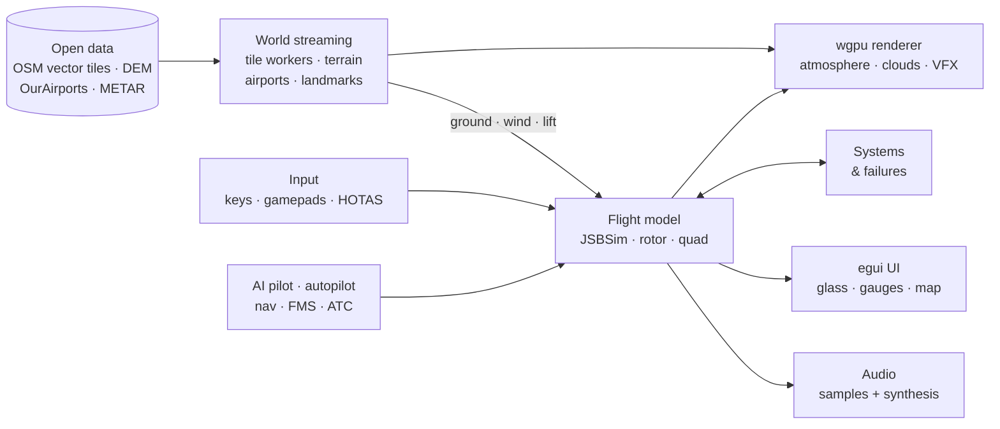

<details>
<summary><b>Floating origin: how long flights stay precise</b></summary>

Positions are f32 metres in a local frame (+X east, −Z north, +Y up): an equirectangular projection
around a movable origin. The frame is re-centred on the aircraft (`World::rebase`) when the aircraft
gets 20 km from the origin, or 2 km north / south of it (a new origin latitude rescales the east–west
axis by cos(lat)).

- **Tiles.** Every map tile is built in **its own frame** and placed with an **exact** affine map,
  so tiles built before and after a shift line up perfectly. The GPU gets that map per tile;
  collision queries apply its inverse.
- **Ground-fixed things.** Runways, airports, sights and the bot's gates move by the same exact map.
- **Things near the aircraft.** The aircraft, cameras, cloud field, turbulence and thermals move by
  the rigid shift at the aircraft, so nothing near it moves.
- **Procedural patterns.** These live in a fixed "pattern space" taken modulo a 16,384 m period, so
  they never jump. Cloud and AO temporal history is re-expressed in the new frame.
- **Rendering.** Every pass is **eye-relative**: tile placement relative to the camera is computed
  in f64, and the view, shadow, reflection and AO matrices are rotation-only. No large numbers
  cancel in f32, so nothing shakes however far you fly.

A shift costs well under 0.1 ms.

</details>

<details>
<summary><b>Frame pacing</b></summary>

The window presents with vsync (FIFO) by default. The simulation advances by the median of recent
frame times, so hitches pass through and a slow correction keeps sim time on wall time. The physics
pose is interpolated between 120 Hz steps, so motion is even at any refresh rate. `--vsync off` or
Settings › Video switches to mailbox / immediate for the lowest latency.

</details>

<details>
<summary><b>Project layout</b></summary>

| Path | What |
|---|---|
| `src/tiles.rs`, `src/mvt.rs`, `src/osm.rs` | tile download, disk cache, worker pool; MVT decoder; projections / frames / tile math |
| `src/scene.rs`, `src/terrain.rs` | per-tile meshes (ground, buildings, trees), collision; DEM grids, drape, runway flattening |
| `src/world.rs` | streaming, floating origin, runway merging, environment queries (ground, wind, lift) |
| `src/traffic/` | road traffic: per-tile lane graphs, microsimulation (worker thread), vehicle meshes, instanced renderer |
| `src/landmarks.rs`, `src/landmarks/` | landmark registry by location and the procedural London models |
| `src/airport/`, `src/airports.rs` | airport detail (markings, stands, signs, lights, vehicles, Overpass, parked fleet); OurAirports database |
| `src/gfx.rs`, `src/gfx_aircraft.rs`, `src/shaders/` | wgpu renderer; textured aircraft renderer; WGSL shaders |
| `src/atmosphere.rs`, `src/clouds.rs`, `src/weather.rs` | sun, sky / aerial-perspective LUTs; volumetric clouds + thermals; METAR / Open-Meteo |
| `src/wx/` | Dryden turbulence field, thunderstorms + lightning + thunder, mountain waves / rotors / lenticulars, wake vortices, weather radar, windscreen rain / wipers / frost |
| `src/vfx/` | particles, trails, vapour, shock diamonds, heat haze, rotor wash; condensation physics |
| `src/flight.rs`, `src/jsbsim.rs` | fixed-wing flight dynamics + aircraft definitions; JSBSim aerodynamics evaluator |
| `src/rotor/` | helicopter rotor / engine / Fenestron model, FPV quad, their bots, VEMD / OSD |
| `src/damage.rs`, `src/debris.rs`, `src/scenario.rs` | structural loads and flex; wreckage; scripted test flights |
| `src/systems/` | per-type systems, failures + schedule, ECAM / EICAS alerts |
| `src/nav/`, `src/autopilot.rs` | navaids, radios, FMS-lite, nav inputs; autopilot |
| `src/atc/` | frequencies, phraseology + voice vocabulary, ATIS, taxi routing, radar vectors |
| `src/bot.rs`, `src/sim.rs` | AI pilot; session, controls, cameras |
| `src/audio/` | sample playback, synthesis, positional mixing, radio chain, offline renderer |
| `src/input/` | game controllers (gilrs + evdev), bindings, layouts, curves, head-look |
| `src/ui/` | design system, instruments (`gauges.rs`, `glass.rs`, `hudsym.rs`), moving map, menus, panels |
| `src/models.rs`, `src/aircraft_asset.rs`, `src/assets.rs` | imported aircraft models and animations; asset loading |
| `src/platform/`, `src/tiles_web.rs`, `web/` | browser build: fetch, localStorage, Web Worker tile pool, page shell |
| `src/net/`, `src/ui/browser.rs`, `src/ui/mp.rs` | multiplayer client: session, remote aircraft, LAN server browser, name tags, chat, player list |
| `crates/skyward-net/` | multiplayer protocol: codec, reliability layer, handshake, clock sync, interpolation, discovery (sans-IO) |
| `crates/skyward-server/` | headless dedicated server: config, console, logging |
| `tools/fgimport/` | offline converter: FlightGear aircraft → Skyward assets (+ neutral liveries) |
| `tools/regress/`, `tests/goldens/` | golden image / audio comparison tool and the committed goldens |
| `assets/` | aircraft, audio, fonts (each with its CREDITS / licence files) |

</details>

## Testing and CI

- **CI** ([`ci.yml`](.github/workflows/ci.yml)) runs on every push and PR: rustfmt on the
  formatted paths, `clippy -D warnings`, unit tests, a release build on Linux, and a wasm32 check.
- **Goldens** need a GPU and the tile cache, so they run locally. `scripts/regress.sh` renders the
  scenes in `tests/goldens/scenes.txt` with fixed time, date and METAR. It compares them with the
  committed PNGs perceptually (CIELAB ΔE + SSIM), and compares audio renders by spectral distance.
  After an intended change, run `scripts/regress.sh --update [scene...]`.
- **Smoke render.** [`render.yml`](.github/workflows/render.yml) is an on-demand software-Vulkan
  (lavapipe) smoke render.

## On the roadmap

These are being built now or planned. They aren't in `main` yet. See [`ROADMAP.md`](ROADMAP.md) and
[`PLAN.md`](PLAN.md).

- **More challenges.** Crosswind and short-field landings, glider task racing, scored tours.
- **More aircraft.** And military types with weapons.
- **Releases and replays.** Native release packages, and a replay / flight recorder.

## Contributing

Issues and pull requests are welcome. Before opening a PR:

1. Run `cargo clippy --all-targets -- -D warnings` and `cargo test`.
2. Run `scripts/fmt-check.sh` (the formatted paths are listed in `scripts/fmt-paths.txt`).
3. If you changed what the sim draws or sounds like, run `scripts/regress.sh` and include any golden
   updates in the PR.

New content must come with a clear, GPL-2.0-compatible licence and an entry in the relevant
`CREDITS.md`.

## Credits and licences

Skyward's own code is **GPL-2.0-or-later**. Some bundled FlightGear content is GPL v2 *only*, so the
combined work is distributed under **GPL v2**. See [`LICENSE`](LICENSE) and [`NOTICE`](NOTICE).

### Aircraft

All from the [FlightGear](https://www.flightgear.org/) community, under the GPL. Sources, licences
and modifications are in each `assets/aircraft/<id>/CREDITS.md`.

| Aircraft | Source | Authors | Licence |
|---|---|---|---|
| Cessna 172P | [c172p-team/c172p](https://github.com/c172p-team/c172p) | David Megginson (original), Gilberto Agostinho, Wayne Bragg, Juan Vera del Campo and the c172p team | GPL-2.0+ |
| ASK 21 | FGAddon `ASK21` | Heiko Schulz, Detlef Faber, Thomas Polzer, Viktor Radnai, Bea Wolf, Gilberto Agostinho, Herbert Wagner, Anders Gidenstam | GPL-2.0+ |
| Spitfire Mk IX | FGAddon `spitfireIX` | Detlef Faber; instruments by AJ MacLeod, Vivian Meazza, Anders Gidenstam | GPL-2.0 |
| F-16C | FGAddon `f16` | Erik Hofman, Nikolai V. Chr., J Maverick 16, Richard Harrison, Josh Davidson and the F-16 team | GPL-2.0+ |
| ATR 72-500 | FGAddon `ATR-72-500` | Ryan Miller | GPL-2.0+ (FGAddon policy) |
| Embraer E190 | [YV3399/E-jet-family-YV](https://github.com/YV3399/E-jet-family-YV) | Gabriel Hernandez, D-ECHO, Tobias Dammers, Semir Gebran, Stefan Frank, Jonathan Redpath, Narendran Muraleedharan and others | GPL-2.0+ |
| Airbus A320 | FGAddon `A320-family` | Josh Davidson, Jonathan Redpath, merspieler, Matthew Maring, Thorsten Herrmann, Semir Gebran | GPL-2.0 only |
| C-130H Hercules | FGAddon `C130` | Emmanuel Baranger, Didier Fabert, Jettoo | GPL-2.0 |
| C-5M Super Galaxy | [FGMEMBERS/C-5](https://github.com/FGMEMBERS/C-5) | Jon Bourgeois, Gary Scott, Peter Brendt | GPL-2.0 |
| Avro Vulcan B.2 | [FGMEMBERS/AvroVulcanB2](https://github.com/FGMEMBERS/AvroVulcanB2) (FGUK) | Stuart Buchanan, FGUK, after Jonathan Harris's GPL model | GPL-2.0 |
| EC130 B4 | FGAddon `ec130` | Heiko Schulz, Melchior Franz, Michael Habarta | GPL-2.0+ |
| FPV quadcopter | Skyward (`src/rotor/quad_model.rs`) | — | GPL-2.0+ |

FGAddon packages are from SourceForge SVN trunk r21799. Type names are used descriptively; the
liveries are neutral, with no operator markings.

### Data and services

| What | Source | Terms |
|---|---|---|
| Map data | © [OpenMapTiles](https://openmaptiles.org/) © [OpenStreetMap contributors](https://www.openstreetmap.org/copyright), served by [OpenFreeMap](https://openfreemap.org/) | ODbL |
| Airport detail | OpenStreetMap via the [Overpass API](https://overpass-api.de/) | ODbL |
| Elevation | [Terrain Tiles](https://registry.opendata.aws/terrain-tiles/) on AWS (Mapzen / Tilezen); sources below | see below |
| Airports, runways, frequencies, navaids | [OurAirports](https://ourairports.com/data/) | Public domain |
| ILS | Synthetic, from OurAirports runway data; a few London ILS frequencies / idents / glidepaths from public charts | — |
| Weather | METARs from [aviationweather.gov](https://aviationweather.gov/) (NOAA); forecasts from [Open-Meteo](https://open-meteo.com/) | Public / CC BY 4.0 |
| Place search fallback | [Nominatim](https://nominatim.org/) | ODbL |
| Live traffic | ADS-B positions from the [adsb.lol](https://adsb.lol/) API (volunteer receivers; no API key, requests carry only a position, a radius and a generic `skyward-flightsim/0.x` User-Agent) | [ODbL 1.0](https://opendatacommons.org/licenses/odbl/1-0/) |

<details>
<summary><b>Elevation data attribution (Terrain Tiles sources)</b></summary>

ArcticDEM terrain data DEM(s) were created from DigitalGlobe, Inc., imagery and funded under
National Science Foundation awards 1043681, 1559691, and 1542736; Australia terrain data ©
Commonwealth of Australia (Geoscience Australia) 2017; Austria terrain data © offene Daten Österreichs
– Digitales Geländemodell (DGM) Österreich; Canada terrain data contains information licensed under
the Open Government Licence – Canada; Europe terrain data produced using Copernicus data and
information funded by the European Union - EU-DEM layers; Global ETOPO1 terrain data U.S. National
Oceanic and Atmospheric Administration; Mexico terrain data source: INEGI, Continental relief, 2016;
New Zealand terrain data Copyright 2011 Crown copyright (c) Land Information New Zealand and the New
Zealand Government (All rights reserved); Norway terrain data © Kartverket; United Kingdom terrain
data © Environment Agency copyright and/or database right 2015. All rights reserved; United States
3DEP (formerly NED) and global GMTED2010 and SRTM terrain data courtesy of the U.S. Geological
Survey. Landmark positions and footprints from OpenStreetMap (ODbL); the models are procedural.

</details>

### Sound, voices and fonts

- **Engine and effect recordings** come from FlightGear aircraft and fgdata: the c172p team,
  Spitfire IX, F-16, DHC-8, A320-family, ASK21 and the FGUK Vulcan. They are GPL v2 / v2+, and
  several sets are GPL v2 only. See
  [`assets/audio/CREDITS.md`](assets/audio/CREDITS.md).
- **Voices.** The cockpit callouts and the ATC / ATIS voices were generated offline for Skyward with
  [Kokoro-82M](https://huggingface.co/hexgrad/Kokoro-82M) (Apache-2.0 model). The clips are released
  with the project.
- **Fonts.** [Inter](https://github.com/rsms/inter),
  [JetBrains Mono](https://github.com/JetBrains/JetBrainsMono) and
  [B612](https://github.com/polarsys/b612) (Airbus / Intactile / ENAC, designed for cockpit
  displays), all under the SIL Open Font License 1.1. See [`assets/fonts/`](assets/fonts).

## Acknowledgements

Skyward stands on the work of others:

- **FlightGear** contributors, who have spent decades building and freely licensing aircraft,
  flight models and sounds.
- **OpenStreetMap** mappers.
- **OpenMapTiles** and **OpenFreeMap**, for vector tiles anyone can use without a key.
- **OurAirports**, for putting the world's aviation data in the public domain.
- **JSBSim**, whose flight-dynamics format and data make realistic aerodynamics portable.
- The Rust graphics ecosystem: **wgpu**, **winit**, **egui**, **glam**.
- Sébastien Hillaire's research on physically based atmosphere rendering.

<p align="center"><sub>Happy landings.</sub></p>
