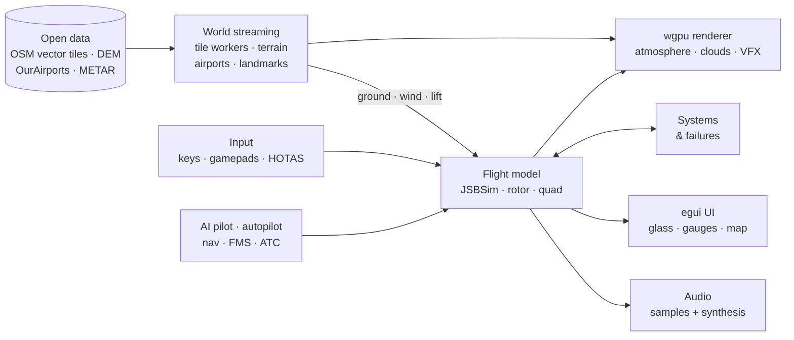

<p align="center">
  
</p>

<h1 align="center">Skyward</h1>

<p align="center">
  <strong>An open-source flight simulator over the real world.</strong><br>
  Endless OpenStreetMap scenery, physically based skies, real aircraft with JSBSim aerodynamics,<br>
  live weather, ILS approaches, ATC on the radio. Native Rust on wgpu, and it runs in your browser too.
</p>

<p align="center">
  <a href="https://github.com/WillMatthews/skyward/actions/workflows/ci.yml"></a>
  <a href="LICENSE"></a>
  <a href="https://www.rust-lang.org/"></a>
  
  <a href="https://github.com/gfx-rs/wgpu"></a>
</p>

<p align="center">
  <a href="https://willmatthews.github.io/skyward/"></a>
  &nbsp;
  <a href="#quick-start"></a>
</p>

<p align="center"><sub>
  The browser version needs a WebGPU browser (recent Chrome or Edge; see <a href="#browser-version">Browser version</a>).
  The native desktop build is the full-quality version.
</sub></p>

<p align="center">
  <a href="#gallery">Gallery</a> ·
  <a href="#features">Features</a> ·
  <a href="#aircraft">Aircraft</a> ·
  <a href="#quick-start">Quick start</a> ·
  <a href="#controls">Controls</a> ·
  <a href="#architecture">Architecture</a> ·
  <a href="#credits-and-licences">Credits</a>
</p>


## Gallery

Every picture is a straight capture from the sim's headless renderer (`skyward --shot`). Nothing is
painted over or composited.

<table>
  <tr>
    <td width="33%" valign="top"><a href="docs/media/gallery/cockpit-a320.jpg"></a><br><sub><b>Live glass.</b> A320 on finals to Heathrow.</sub></td>
    <td width="33%" valign="top"><a href="docs/media/gallery/ils-pfd-nd.jpg"></a><br><sub><b>ILS and autoland.</b> LOC and G/S captured.</sub></td>
    <td width="33%" valign="top"><a href="docs/media/gallery/cockpit-c172.jpg"></a><br><sub><b>Steam gauges.</b> Cessna 172P, golden hour.</sub></td>
  </tr>
  <tr>
    <td valign="top"><a href="docs/media/gallery/heathrow.jpg"></a><br><sub><b>Real airports.</b> Heathrow T5 stands.</sub></td>
    <td valign="top"><a href="docs/media/gallery/london-night.jpg"></a><br><sub><b>Night.</b> Tower Bridge and the City.</sub></td>
    <td valign="top"><a href="docs/media/gallery/clouds-glider.jpg"></a><br><sub><b>Volumetric clouds.</b> ASK 21 under cumulus.</sub></td>
  </tr>
  <tr>
    <td valign="top"><a href="docs/media/gallery/alps-innsbruck.jpg"></a><br><sub><b>Terrain.</b> The Inn valley at Innsbruck.</sub></td>
    <td valign="top"><a href="docs/media/gallery/vapour-cone.jpg"></a><br><sub><b>VFX.</b> F-16 vapour cone, Mach 0.98.</sub></td>
    <td valign="top"><a href="docs/media/gallery/rotor-wash.jpg"></a><br><sub><b>Rotorcraft.</b> EC130 rotor wash.</sub></td>
  </tr>
  <tr>
    <td valign="top"><a href="docs/media/gallery/fpv-osd.jpg"></a><br><sub><b>FPV drone.</b> Canary Wharf, quad camera.</sub></td>
    <td valign="top"><a href="docs/media/gallery/failures-ecam.jpg"></a><br><sub><b>Failures.</b> Engine fire, ECAM.</sub></td>
    <td valign="top"><a href="docs/media/gallery/crash-vfx.jpg"></a><br><sub><b>Crashes.</b> Debris, fire, smoke.</sub></td>
  </tr>
</table>

## Features

### The world

- **Anywhere on Earth, endlessly.** OpenMapTiles vector tiles from OpenFreeMap (no API key) stream in
  around you: extruded buildings with facades and lit windows, trees, roads, rivers, parks and
  airfields out to ~7.5 km, a generalised far field to ~30 km, terrain to ~95 km.
- **Real terrain.** DEM elevation (AWS Terrain Tiles) under every level of detail, with map layers
  draped exactly onto it, levelled lakes and runways, ridge shadows, rock and a seasonal snow line.
- **Landmarks.** Procedural models built to real dimensions replace the OSM boxes: the Shard, Tower
  Bridge, the London Eye (its wheel turns), St Paul's, Big Ben, the Gherkin, Battersea and more.
  Floodlit at night.
- **~49,000 airports** from OurAirports, each detailed from map data, Overpass and procedural fill:
  markings, holding points, terminals, hangars, towers, jet bridges, parked aircraft, driving
  ground vehicles, windsocks in the real wind, lit signs, taxiway lights and stop bars.
- **Fly as far as you like.** A floating origin re-centres the world as you fly, so London to Paris
  and beyond stays precise and hitch-free.

### Rendering

- **Physically based sky.** Hillaire-style atmosphere with aerial perspective, AgX tonemapping,
  bloom, cascaded shadows, SSAO, planar water reflections and MSAA HDR.
- **Volumetric clouds.** Ray-marched cumulus, stratus and cirrus with temporal reprojection and
  cloud shadows on the ground.
- **Weather and seasons.** Rain, snow, fog and wet ground; leaf fall, autumn colours and crop
  calendars.
- **Night.** Moon and stars, skyglow, street lights, lit windows, moving traffic, airport lighting,
  PAPIs and landing lights.
- **Effects.** Transonic vapour cones, afterburner shock diamonds, heat haze, Schmidt–Appleman
  contrails, wingtip vortices, rotor wash, fireballs, fuel fires, smoke, dust and spray.

### Flight

- **One 6-DoF flight model for fixed wings.** It covers the ISA atmosphere, engines and propellers,
  gear, spoilers, reversers, asymmetric thrust and FBW control laws. **JSBSim aerodynamics** are
  evaluated at run time for the types that ship JSBSim data.
- **Skyward's own rotorcraft model.** Blade-element and momentum main rotor with rotor RPM, a FADEC
  turboshaft, Fenestron, translational lift, ground effect, vortex ring state, retreating-blade
  stall, dynamic rollover and **autorotation** to a flared landing.
- **Structure and crashes.** Wings flex with load. There are limit and ultimate load factors,
  flutter and overspeeds, and parts that tear off and change the aerodynamics. Survivable accidents
  slide to a stop; fatal ones break into rigid-body debris that tumbles, burns and sinks.
- **Ground handling.** Every wheel has a tyre model: slip ratio with the wheel's spin (spin-up
  smoke at touchdown, locked-wheel skids, anti-skid), slip angle and the friction ellipse, oleo
  struts, rolling resistance. Friction depends on the surface and the weather: dry / wet /
  flooded asphalt and concrete, grass, gravel, dirt, slush, snow and ice, with **hydroplaning**
  above 9·√p kt. Steel and carbon brakes heat up, fade, show on the ECAM / EICAS WHEEL page and
  melt their fusible plugs. Autobrake LO / MED / MAX / RTO, parking brake, chocks, ground power,
  **nose-wheel tillers** (pedals steer only a few degrees), castering nose wheels and tail wheels
  with differential braking, a lockable DC-3 tail wheel — and real ground loops in taildraggers.
  **Pushback** by a tug (straight, tail left / right), **taxi guidance** with
  **follow-the-greens** centreline lights and the route on the moving map, and an auto-flight
  bot that pushes back and taxis the taxiway network to the holding point and back to a stand.
- **Live weather and wind.** The nearest METAR plus Open-Meteo drive clouds, visibility,
  precipitation, the wind gradient, gusts, turbulence and drifting thermals. Real local time and
  date, re-fetched along long flights.

### Systems, navigation and ATC

- **Systems per type.** Electrics, fuel (burn feeds mass and CG), hydraulics, vacuum and
  pitot-static, engine starts from cold and dark, APU, anti-ice and icing.
- **Failures.** 24 failures behave like the real ones: fires, flameouts, a pitot blockage that turns
  the ASI into an altimeter, toppling gyros, gear that needs the alternate extension, tyre bursts,
  bird strikes. Each brings master warning or caution, an ECAM / EICAS procedure that ticks off as
  you fly it, and the aural alerts. Fail anything now, arm it, or set random failures by MTBF.
- **Navigation.** VOR, DME and NDB from OurAirports, plus an ILS for every instrument runway. NAV,
  COM and ADF radios have range, radio horizon and terrain line of sight, and Morse idents. There is
  an FMS-lite flight plan with an MCDU page, and PFD and ND in ROSE / ARC / PLAN.
- **Autopilot and autoland.** HDG, ALT, V/S, SPD, LOC, VOR, LNAV, VNAV and APPR with no-overshoot
  captures. The airliners flare, retard and roll out on the localizer.
- **ATC and ATIS on the radio.** Each airport's real frequencies. UK CAP 413 phraseology in six
  synthesised voices, played through an AM airband chain with subtitles. ATIS reads the live METAR.
  ATC covers clearance, taxi routing over the taxiway graph, take-off, radar vectors to the ILS,
  landing and taxi-in, and reacts to level busts, incursions and MAYDAYs.

### Everything else

- **Emergency missions.** Twelve airline emergencies, fictional but inspired by real incidents. You fly each one through to a safe outcome:
  a V1 engine fire, rapid decompression, a belly landing, unreliable airspeed at night, a microburst on final, an uncontained engine failure,
  a dual bird strike over the Thames (land or ditch), smoke with a clock running, jammed flaps in a crosswind, a fuel-exhaustion glide and
  thrust-only control. Each has a briefing, live objectives, cabin PA, fire tenders and a scored debrief with medals.
- **Sound.** Real FlightGear engine recordings mixed with Skyward's own synthesis: prop blade-pass,
  afterburner crackle, positional / Doppler mixing, sonic-boom N-waves, GPWS callouts, impacts.
- **Instruments.** Full 3D cockpits with live needles and glass displays, a 2D glass or steam-gauge
  overlay per class, a conformal HUD in the fighter, and a vector moving map with day, night and ND
  styles.
- **Input devices.** Gamepads, joysticks and HOTAS, throttle quadrants and rudder pedals, all at
  once and hot-pluggable. Curves, deadzones, calibration, rebinding, mouse yoke and head-look.
- **Watch mode.** An AI pilot flies the real flight model through the controls: take-off,
  sightseeing tour, approach and landing, wind-aware, doing its own radio calls. The glider bot
  thermals under cumulus. Add the cinematic camera and leave it running.
- **Menus.** Aircraft cards, a world-map airport picker with fuzzy search, runway diagrams with
  live crosswind, and conditions from live to any METAR.

## Aircraft

Twelve flyable types. The FlightGear models, cockpits and flight-dynamics data are GPL, credited per
aircraft in [`assets/aircraft/<id>/CREDITS.md`](assets/aircraft) and rebuilt by
[`tools/fgimport/`](tools/fgimport).

<table>
  <tr>
    <td width="190" valign="top"></td>
    <td valign="top"><b>Cessna 172P Skyhawk</b><br><code>kestrel</code> <sub>(<code>c172</code>)</sub><br><sub><i>JSBSim flight model</i></sub><br><sub>The trainer. KAP 140 autopilot, 3D radios and steam gauges.</sub></td>
    <td width="190" valign="top"></td>
    <td valign="top"><b>Schleicher ASK 21</b><br><code>swift</code> <sub>(<code>ask21</code>)</sub><br><sub><i>JSBSim flight model</i></sub><br><sub>Two-seat sailplane. TE vario with MacCready ring; released near a thermal.</sub></td>
  </tr>
  <tr>
    <td width="190" valign="top"></td>
    <td valign="top"><b>Supermarine Spitfire Mk IX</b><br><code>peregrine</code> <sub>(<code>spitfire</code>)</sub><br><sub><i>Calibrated flight model</i></sub><br><sub>Merlin warbird. Swings on take-off, torque, P-factor.</sub></td>
    <td width="190" valign="top"></td>
    <td valign="top"><b>General Dynamics F-16C</b><br><code>lancer</code> <sub>(<code>f16</code>)</sub><br><sub><i>JSBSim flight model</i></sub><br><sub>FBW fighter with afterburner, conformal HUD, supersonic.</sub></td>
  </tr>
  <tr>
    <td width="190" valign="top"></td>
    <td valign="top"><b>ATR 72-500</b><br><code>aerolink</code> <sub>(<code>atr72</code>)</sub><br><sub><i>Calibrated flight model</i></sub><br><sub>Twin-turboprop regional airliner, reverse pitch.</sub></td>
    <td width="190" valign="top"></td>
    <td valign="top"><b>Embraer E190</b><br><code>meridian190</code> <sub>(<code>e190</code>)</sub><br><sub><i>JSBSim flight model</i></sub><br><sub>Regional jet, autoland.</sub></td>
  </tr>
  <tr>
    <td width="190" valign="top"></td>
    <td valign="top"><b>Airbus A320-200</b><br><code>meridian320</code> <sub>(<code>a320</code>)</sub><br><sub><i>JSBSim flight model</i></sub><br><sub>Normal-law FBW, live PFD / ND / ECAM / MCDU, autoland.</sub></td>
    <td width="190" valign="top"></td>
    <td valign="top"><b>Lockheed C-130H Hercules</b><br><code>hercules</code> <sub>(<code>c130</code>)</sub><br><sub><i>Calibrated flight model</i></sub><br><sub>Four T56s, short and rough fields (grass OK), cargo ramp.</sub></td>
  </tr>
  <tr>
    <td width="190" valign="top"></td>
    <td valign="top"><b>Lockheed C-5M Super Galaxy</b><br><code>galaxy</code> <sub>(<code>c5</code>)</sub><br><sub><i>JSBSim + patches flight model</i></sub><br><sub>280 t airlifter. Slow-spooling CF6s, huge inertia.</sub></td>
    <td width="190" valign="top"></td>
    <td valign="top"><b>Avro Vulcan B.2</b><br><code>vulcan</code><br><sub><i>JSBSim + delta aero flight model</i></sub><br><sub>No stall break, big high-alpha drag, the Olympus howl.</sub></td>
  </tr>
  <tr>
    <td width="190" valign="top"></td>
    <td valign="top"><b>Airbus Helicopters EC130 B4</b><br><code>ec130</code> <sub>(<code>heli</code>)</sub><br><sub><i>Skyward rotor flight model</i></sub><br><sub>Collective, cyclic, pedals. VEMD, autorotation, stability assist.</sub></td>
    <td width="190" valign="top"></td>
    <td valign="top"><b>5″ FPV quadcopter</b><br><code>fpv</code> <sub>(<code>quad</code>, <code>drone</code>)</sub><br><sub><i>Skyward quad flight model</i></sub><br><sub>Acro / angle modes, Betaflight-style rates, 6S sag, OSD.</sub></td>
  </tr>
</table>

<sub>"Calibrated" = Skyward's parametric model tuned to the package's YASim data and published
figures. The FPV quad's model is Skyward's own; every other model is a FlightGear aircraft with a
neutral livery.</sub>

## Quick start

**Prerequisites:** Rust **1.98+** ([rustup](https://rustup.rs/)) and a GPU with Vulkan. On Linux,
also the ALSA and udev headers:

```sh
# Debian / Ubuntu
sudo apt install pkg-config libasound2-dev libudev-dev
# Fedora
sudo dnf install pkgconf-pkg-config alsa-lib-devel systemd-devel
```

**Build and fly:**

```sh
git clone https://github.com/WillMatthews/skyward
cd skyward
cargo run --release
```

The first run downloads map tiles, terrain and the airport list into `cache/`; after that it works
from the cache. On hybrid-graphics laptops Skyward asks for the high-performance GPU.

> [!NOTE]
> Linux is the primary, CI-tested platform. The stack (wgpu, winit, cpal, gilrs) is cross-platform,
> so Windows (DX12 / Vulkan) and macOS (Metal) builds should work, but they aren't tested in CI yet.
> Reports and fixes are welcome.

**A few ways in:**

```sh
cargo run --release -- --airport EGLL                     # any ICAO / IATA / name
cargo run --release -- --airport EGKK --aircraft a320 --start-at final:26L:5 --no-menu
cargo run --release -- --airport LOWI --aircraft c172     # Innsbruck, in the Alps
cargo run --release -- --watch --aircraft vulcan          # sit back: AI pilot + cinematic camera
```

### Browser version

The same code builds for the web (wasm32 + **WebGPU**). It has menus, every aircraft, streamed
scenery, terrain, live weather and sound in a tab.
**Play it at [willmatthews.github.io/skyward](https://willmatthews.github.io/skyward/)**.

<details>
<summary><b>Browser requirements, differences and building it locally</b></summary>

- **Browsers.** WebGPU is required: Chrome / Edge 113+ (Windows, macOS, ChromeOS, Android; on Linux
  behind `chrome://flags/#enable-unsafe-webgpu`), Safari 26+, or Firefox 141+ on Windows. Without it
  the page says so.
- **Download.** ≈15 MB of wasm (≈9 MB gzipped) before the first flight, then the chosen aircraft
  (2–15 MB) and the airport list (≈4 MB compressed, once per browser cache). Map, terrain and weather
  stream as on the desktop; the browser's HTTP cache stands in for `cache/`.
- **Differences from native.**
  - No live METARs: aviationweather.gov sends no CORS headers, so weather comes from Open-Meteo.
  - Settings are kept in `localStorage`.
  - Lighter defaults: low scenery detail, 2048² shadow cascades, and the 3D view drawn at
    ≤ 1.6 Mpixel and scaled up.
  - Sound starts after you click Fly.
  - No aircraft-card thumbnails and no Quit button.
  - Tiles are built in Web Workers (`src/tiles_web.rs`).
- **URL options.** The query string is the command line, e.g.
  `?airport=EGKK&aircraft=meridian320&no-menu`, `?watch`, `?time=12.00`. `?scale=0.5` renders the 3D
  view at half size; `?noworkers` builds tiles on the page.

Build and serve locally (127.0.0.1 only):

```sh
rustup target add wasm32-unknown-unknown
cargo install wasm-bindgen-cli --version 0.2.130 --locked   # = Cargo.lock's wasm-bindgen
cargo install wasm-opt --locked                              # optional (smaller, faster wasm)
scripts/web-serve.sh            # build dist/ and serve http://127.0.0.1:8098/
scripts/web-build.sh            # build dist/ only
```

[`.github/workflows/pages.yml`](.github/workflows/pages.yml) builds `dist/` on pushes to `main` and
deploys it to GitHub Pages.

</details>

## Controls

Every key can be rebound in **Settings › Controls**. Press **H** or **F1** in flight for help.

| Key | Action | Key | Action |
|---|---|---|---|
| **W S / ↑ ↓** | Pitch | **G** | Gear |
| **A D / ← →** | Roll | **F / V** | Flaps (glider: airbrakes) |
| **Q E** | Rudder / steer | **B** or **Space** | Brakes |
| **Shift / Ctrl** | Throttle | **Z** | Autopilot on / off |
| **C** | Camera: chase, cockpit, tower, fly-by, cinematic | **2** | APPR: ILS capture and autoland |
| **Right-drag, wheel** | Look / orbit, zoom | **J** | Hand over to the AI pilot |
| **M** | Moving map | **F3** / **F4** | Radios & flight plan / ATC comms |
| **Esc** | Pause menu | **O** / **F2** | Systems & failures |
| **Backspace** | Parking brake | **Enter** | Pushback (again: direction / stop) |
| **Num / *** | Nose-wheel tiller | **Left Alt** | Taxi route + follow the greens |

<details>
<summary><b>Full keyboard reference</b></summary>

| Key | Action |
|---|---|
| ↑ / W, ↓ / S | pitch down / up |
| ← / A, → / D | roll |
| Q / E | rudder (steers on the ground) |
| Shift / Ctrl, = / -, PgUp / PgDn | throttle (Lancer: above the 90 % detent = afterburner) |
| F / V | flaps (glider: airbrakes) out / in |
| G | landing gear up / down (3 green = down and locked, red = in transit) |
| / and \ (or ') | spoilers / speed brake out / in one step |
| T | thrust reverse on / off (ground only; throttle then sets reverse power) |
| B or Space (hold) | brakes (single-lever types split them with the rudder) |
| Num 0 / Num Enter (hold) | left / right toe brake |
| Num / / Num * (hold) | nose-wheel tiller left / right (airliners; without a tiller the rudder keys work it below ~30 kt) |
| Backspace | parking brake set / release |
| F11 | autobrake OFF → LO → MED → MAX (Embraer: RTO too); pedal braking or thrust disarms it |
| Enter | pushback: request (straight back), again within 3 s for tail left / right; during the push: stop. Set the parking brake when told, the tug disconnects |
| Caps Lock | chocks + ground power in / out (the crew also puts them in 20 s after you park with the engines off) |
| Right Alt | tail-wheel lock (DC-3) |
| Left Alt | taxi guidance: route to the departure holding point (or, after a flight, to a free stand) on the moving map, follow-the-greens lights, next turn and speed |
| [ / ] | trim nose down / up |
| Z | autopilot on (holds heading, altitude, speed) / off; a mouse AP panel appears |
| Ins / Del, Home / End, 9 / 0 | autopilot heading ∓5°, altitude ±100 ft, speed ∓5 kt |
| 1 / 2 / 3 / 4 | autopilot LOC (VOR) track on NAV 1 / **APPR** (LOC + G/S, autoland on airliners) / LNAV (flight plan) / VNAV; arm, press again to cancel |
| 5, 6 / 7, 8 | NAV 1: swap active ↔ standby, course (OBS) −/+ 1°, Morse ident audio |
| F3 | **radios & flight plan** panel: COM / NAV / ADF frequencies, course, ident, transponder; route, destination + approach, direct-to, predictions |
| F5 / F7–F10 | **split throttles**: F7/F8 left engines −/+, F9/F10 right engines −/+, F5 brings the levers back together |
| F4 | **ATC comms menu**: the requests for the unit on COM 1 (1–9 pick, 0 = tune a station, Esc closes), read-back / assist / subtitle / COM 2 options |
| ; | navigation display: ROSE ILS → ROSE VOR → ROSE NAV → ARC → PLAN |
| K | engine-failure practice (fails engine 1, then 2, then restores) |
| O / F2 | **systems & failures** panel: fail / arm / random failures, repair; systems (battery, generators, fuel, engine start, APU, hydraulics, anti-ice, alternate gear, fire handles) |
| ` | master warning / caution reset (silences the chime) |
| J | **auto flight**: the bot flies; any stick / throttle / lever input takes back |
| C | camera: chase → cockpit → tower → fly-by → cinematic |
| Right-drag, wheel | orbit / zoom chase camera; in the cockpit: look around |
| Num 4 / 6 / 8 / 2, Num 5 | glance left / right / up / down (hold), centre the view |
| Y | mouse yoke on / off (enable it in Settings › Controls › Mouse & view) |
| M, `,` / `.` | moving map: corner / large / off, range out / in |
| U | instruments: full / minimal / off |
| I | weather panel: expand / collapse |
| N | mute sound |
| X | time warp 1 / 2 / 4 / 8× |
| P | pause |
| R | restart (back at the start point) |
| Esc / Tab | pause menu: resume, restart, change aircraft / airport, settings |
| H / F1 | help |
| F12 | screenshot |

Stick inputs disconnect the autopilot (flashing AP DISCONNECT); throttle keys only drop the
autothrottle.

**Helicopter (EC130):** collective on the throttle, cyclic on the stick, pedals on the rudder;
G or F6 cycles the stability assist (attitude hold → off → SAS); K fails the engine (autorotation).
**FPV quad:** G or `;` switches angle / rate (acro) mode; C → cockpit is the FPV camera with OSD; on
a gamepad both sticks fly "mode 2".

</details>

<details>
<summary><b>Game controllers, joysticks and pedals</b></summary>

Gamepads, joysticks / HOTAS, throttle quadrants and rudder pedals work out of the box and can be
used together (gilrs: Linux evdev, Windows, macOS, browser Gamepad API; on Linux, button-less pedals
are read straight from evdev). Hot-plug is supported. Each device model gets a default layout the
first time it's seen:

- **Xbox / PlayStation pads.** Left stick flies, triggers are rudder, right stick looks, bumpers are
  throttle.
- **Sticks** (T.16000M, X52, Extreme 3D...). Twist is rudder, the slider / Z axis is throttle, the hat
  glances.
- **Throttles** (TCA quadrant, X56). One lever per engine.
- **Pedals.** Rudder plus left / right toe brakes (each brakes its own main wheels). A
  **Nose-wheel tiller** axis can be bound in Settings › Controls (Ground).

Layouts are saved per device in the settings file.

**Settings › Controls** binds any axis or button when you move or press it. Each axis has a
deadzone, response curve, sensitivity, invert and calibration, with a live response plot. You also
get conflict warnings, per-device enable / reset, mouse yoke and head-look. `skyward --controllers`
lists devices and prints their inputs; `SKYWARD_FAKE_INPUT=xbox,x52,t16000m,tca,pedals` adds virtual
devices for tests.

</details>

<details>
<summary><b>Watch mode: what the AI pilot does</b></summary>

Tick **Auto flight (watch)** in the menu, pass `--watch`, or press **J** in flight. The bot flies
the real flight model through the controls and autopilot. Nothing is scripted or teleported.

- **Glider.** Reads the total-energy vario and judges cumulus by size. It flies the MacCready
  speed-to-fly and centres thermals in the frame that drifts with the wind aloft. It always keeps a
  runway within safe glide, and lands into wind when the lift runs out.
- **Powered.**
  1. Takes off into wind and climbs on the autopilot.
  2. Tours landmarks.
  3. Flies an obstacle-checked approach, coupling to the ILS where there is one.
  4. Flares and rolls out with spoilers, reversers and brakes.
  5. Where the airport's taxiway layout is known: vacates, taxis to a free stand, parks, is pushed
     back by a tug and taxis the taxiway network to the holding point (slow in the turns, main
     gear on the centreline), lines up and goes again. Elsewhere it taxis the runway, turns round
     and repeats.
- **Wind.** Every leg is flown as a track. The bot picks the runway end by headwind and adds half
  the headwind plus the gust to the approach speed. It de-crabs with rudder and holds the centreline
  wing-low in the flare.
- **Radio.** In watch mode the bot also does its own radio work with ATC.

</details>

<details>
<summary><b>Command line</b></summary>

| Flag | Meaning |
|---|---|
| `--lat L --lon L` | start point (default EGLC 51.5045, 0.0300) |
| `--airport CODE` | start at an airport (OurAirports ident / ICAO / IATA / name; Nominatim fallback) |
| `--start-at SPEC` | `runway:27L`, `final:27L:5` (NM), `apron`, `stand` / `stand:NAME` (parked nose-in: push back to leave), `air:LAT:LON:ALT_M:HDG`, `thermal` |
| `--runway COND` | runway condition: `dry` `damp` `wet[:MM]` `flooded[:MM]` `slush[:MM]` `snow[:MM]` `ice` `wet-ice` (default: from the weather) |
| `--start S` | `runway` `approach` `city` `thermal` |
| `--aircraft ID` | `kestrel` `swift` `peregrine` `lancer` `aerolink` `meridian190` `meridian320` `hercules` `galaxy` `vulcan` `ec130` `fpv` (or `c172` `ask21` `spitfire` `f16` `atr72` `e190` `a320` `c130` `c5` `heli` `quad` `drone`) |
| `--no-menu` | fly straight away (skip the main menu) |
| `--bot` / `--watch` | hand the aircraft to the auto-flight bot / + cinematic camera (+ glider relaunch) |
| `--live` / `--no-live` | follow the real weather and time (default on) / don't |
| `--metar "RAW"` | fixed weather from a METAR, e.g. `"EGLC 121450Z 18015G25KT 9999 SCT040 15/08 Q1015"` |
| `--weather W` | cloud preset `clear` `few` `scattered` `broken` `overcast` |
| `--time HH.MM`, `--date MM-DD` | local clock time (turns live time off), date (season, sun) |
| `--route LAM,BIG,EGLL/27R[/rnav]` | flight plan: navaids / airports / `lat:lon`, the last item an approach |
| `--fail pitot,vacuum,fire2@30` | systems failures by id, optionally armed `@S` seconds in |
| `--cold-dark` | start cold and dark |
| `--vsync on\|off` | present with vsync (default on) / mailbox or immediate |
| `--hud full\|minimal\|off`, `--map corner\|large\|off` | instrument / map mode |
| `--radius-km R`, `--map-zoom N` | detailed-tile load radius, moving-map zoom step 0–5 |
| `--mute` | start muted |
| `--controllers` | list game controllers and print their inputs |

**Headless (no window).** These render offscreen and write a PNG. They're used for the screenshots
on this page, the golden tests and soak tests.

| Flag | Meaning |
|---|---|
| `--shot out.png`, `--width W --height H` | headless capture (default 1920×1080) |
| `--cam C` | `chase` `cockpit` `tower` `flyby` `cinematic` |
| `--seconds S`, `--warp N` | fly S seconds first (fast-forward), time warp 1–64 |
| `--throttle T`, `--heading DEG`, `--ap` | throttle, initial heading, engage the autopilot |
| `--gear up\|down`, `--flaps N`, `--spoilers F`, `--reverse` | aircraft setup |
| `--panel failures\|armed\|systems\|radios\|fms\|comms` | show a panel |
| `--press ap,ap_appr,nd_mode` | press keys (Settings › Controls ids) after the spawn |
| `--audio-script "2:atc=clearance,40:atc=taxi"` | scripted cues, including ATC requests (see `src/audio/render.rs`) |
| `--eye x,y,z --look x,y,z`, `--eye-ll lat,lon,h --look-ll lat,lon,h` | fixed camera (local frame / by geography) |
| `--menu-screen S` | capture a menu: `main` `aircraft` `airport` `conditions` `settings` `pause` `loading` `credits` |
| `--no-hud`, `--stats` | hide the HUD, print the final state |
| `--realtime [--fps HZ]`, `--then-reset` | stream + render in real time; frame-time / streaming report |
| `--soak [--shot-every S]` | fly the bot for `--seconds` of sim time; minute log, events, PNGs |
| `--rebase-check` | floating-origin test (render, shift the origin, render, compare) |

```sh
# London → Paris (≈340 km) at warp 8, then a picture
skyward --shot paris.png --aircraft lancer --start city --heading 151 --ap --seconds 205 --warp 8
# airliner bot in a 15 kt crosswind for 70 minutes of sim time
skyward --shot m.png --aircraft meridian320 --bot --soak --seconds 4200 --warp 8 --no-live --metar "EGLC 121150Z 18015KT 9999 SCT040 18/08 Q1015"
```

**Environment knobs for tests and captures:**

| Variable | Effect |
|---|---|
| `SKYWARD_SCENARIO=…` | `pullup` `overg` `bellyland` `hardland` `crash` `transonic` `cruise`: a scripted structures / crash / effects flight (`src/scenario.rs`) |
| `SKYWARD_ORBIT=yaw,pitch,dist` | chase-camera angle for captures |
| `SKYWARD_LOOK=yaw,pitch` | cockpit head-look for captures |
| `SKYWARD_COCKPIT_FOV=deg` | cockpit field of view for captures |
| `SKYWARD_NO_VFX`, `SKYWARD_NO_AIRPORTS`, `SKYWARD_NO_OVERPASS`, `SKYWARD_NO_LANDMARKS`, `SKYWARD_FLAT_TERRAIN` | switch layers off |
| `SKYWARD_GPU_TIMING`, `SKYWARD_UI_TIMING`, `SKYWARD_VFX_STATS` | per-pass GPU timing, UI CPU cost, effect counts |
| `SKYWARD_FRAME_LOG=file`, `SKYWARD_SOAK_LOG=10`, `SKYWARD_REBASE_LOG` | frame times, soak log interval, origin shifts |
| `SKYWARD_AIRPORT_DEBUG`, `SKYWARD_TERRAIN_DEBUG`, `SKYWARD_DEBUG_DEBRIS`, `BOT_TRACE=Final,Flare` | debug logging |
| `SKYWARD_UI_SCRIPT="4:aircraft,7:departure,10:airport=EGKK,12:fly"` | drive the menus for tests |

</details>

## Architecture

A single Rust crate. The simulation and world streaming are platform-independent; `src/platform/`
adapts fetch, storage and threading for the browser.



<details>
<summary><b>Floating origin: how long flights stay precise</b></summary>

Positions are f32 metres in a local frame (+X east, −Z north, +Y up): an equirectangular projection
around a movable origin. The frame is re-centred on the aircraft (`World::rebase`) when the aircraft
gets 20 km from the origin, or 2 km north / south of it (a new origin latitude rescales the east–west
axis by cos(lat)).

- **Tiles.** Every map tile is built in **its own frame** and placed with an **exact** affine map,
  so tiles built before and after a shift line up perfectly. The GPU gets that map per tile;
  collision queries apply its inverse.
- **Ground-fixed things.** Runways, airports, sights and the bot's gates move by the same exact map.
- **Things near the aircraft.** The aircraft, cameras, cloud field, turbulence and thermals move by
  the rigid shift at the aircraft, so nothing near it moves.
- **Procedural patterns.** These live in a fixed "pattern space" taken modulo a 16,384 m period, so
  they never jump. Cloud and AO temporal history is re-expressed in the new frame.
- **Rendering.** Every pass is **eye-relative**: tile placement relative to the camera is computed
  in f64, and the view, shadow, reflection and AO matrices are rotation-only. No large numbers
  cancel in f32, so nothing shakes however far you fly.

A shift costs well under 0.1 ms.

</details>

<details>
<summary><b>Frame pacing</b></summary>

The window presents with vsync (FIFO) by default. The simulation advances by the median of recent
frame times, so hitches pass through and a slow correction keeps sim time on wall time. The physics
pose is interpolated between 120 Hz steps, so motion is even at any refresh rate. `--vsync off` or
Settings › Display switches to mailbox / immediate for the lowest latency.

</details>

<details>
<summary><b>Project layout</b></summary>

| Path | What |
|---|---|
| `src/tiles.rs`, `src/mvt.rs`, `src/osm.rs` | tile download, disk cache, worker pool; MVT decoder; projections / frames / tile math |
| `src/scene.rs`, `src/terrain.rs` | per-tile meshes (ground, buildings, trees), collision; DEM grids, drape, runway flattening |
| `src/world.rs` | streaming, floating origin, runway merging, environment queries (ground, wind, lift) |
| `src/landmarks.rs`, `src/landmarks/` | landmark registry by location and the procedural London models |
| `src/airport/`, `src/airports.rs` | airport detail (markings, stands, signs, lights, vehicles, Overpass, parked fleet); OurAirports database |
| `src/gfx.rs`, `src/gfx_aircraft.rs`, `src/shaders/` | wgpu renderer; textured aircraft renderer; WGSL shaders |
| `src/atmosphere.rs`, `src/clouds.rs`, `src/weather.rs` | sun, sky / aerial-perspective LUTs; volumetric clouds + thermals; METAR / Open-Meteo |
| `src/vfx/` | particles, trails, vapour, shock diamonds, heat haze, rotor wash; condensation physics |
| `src/flight.rs`, `src/jsbsim.rs` | fixed-wing flight dynamics + aircraft definitions; JSBSim aerodynamics evaluator |
| `src/rotor/` | helicopter rotor / engine / Fenestron model, FPV quad, their bots, VEMD / OSD |
| `src/damage.rs`, `src/debris.rs`, `src/scenario.rs` | structural loads and flex; wreckage; scripted test flights |
| `src/systems/` | per-type systems, failures + schedule, ECAM / EICAS alerts |
| `src/nav/`, `src/autopilot.rs` | navaids, radios, FMS-lite, nav inputs; autopilot |
| `src/atc/` | frequencies, phraseology + voice vocabulary, ATIS, taxi routing, radar vectors |
| `src/bot.rs`, `src/sim.rs` | AI pilot; session, controls, cameras |
| `src/audio/` | sample playback, synthesis, positional mixing, radio chain, offline renderer |
| `src/input/` | game controllers (gilrs + evdev), bindings, layouts, curves, head-look |
| `src/ui/` | design system, instruments (`gauges.rs`, `glass.rs`, `hudsym.rs`), moving map, menus, panels |
| `src/models.rs`, `src/aircraft_asset.rs`, `src/assets.rs` | imported aircraft models and animations; asset loading |
| `src/platform/`, `src/tiles_web.rs`, `web/` | browser build: fetch, localStorage, Web Worker tile pool, page shell |
| `tools/fgimport/` | offline converter: FlightGear aircraft → Skyward assets (+ neutral liveries) |
| `tools/regress/`, `tests/goldens/` | golden image / audio comparison tool and the committed goldens |
| `assets/` | aircraft, audio, fonts (each with its CREDITS / licence files) |

</details>

## Testing and CI

- **CI** ([`ci.yml`](.github/workflows/ci.yml)) runs on every push and PR: rustfmt on the
  formatted paths, `clippy -D warnings`, unit tests, a release build on Linux, and a wasm32 check.
- **Goldens** need a GPU and the tile cache, so they run locally. `scripts/regress.sh` renders the
  scenes in `tests/goldens/scenes.txt` with fixed time, date and METAR. It compares them with the
  committed PNGs perceptually (CIELAB ΔE + SSIM), and compares audio renders by spectral distance.
  After an intended change, run `scripts/regress.sh --update [scene...]`.
- **Smoke render.** [`render.yml`](.github/workflows/render.yml) is an on-demand software-Vulkan
  (lavapipe) smoke render.

## On the roadmap

These are being built now or planned. They aren't in `main` yet. See [`ROADMAP.md`](ROADMAP.md) and
[`PLAN.md`](PLAN.md).

- **More challenges.** Crosswind and short-field landings, glider task racing, scored tours.
- **Multiplayer.** A shared sky.
- **Live traffic.** Real ADS-B traffic as AI aircraft.
- **More aircraft.** And military types with weapons.
- **Releases and replays.** Native release packages, and a replay / flight recorder.

## Contributing

Issues and pull requests are welcome. Before opening a PR:

1. Run `cargo clippy --all-targets -- -D warnings` and `cargo test`.
2. Run `scripts/fmt-check.sh` (the formatted paths are listed in `scripts/fmt-paths.txt`).
3. If you changed what the sim draws or sounds like, run `scripts/regress.sh` and include any golden
   updates in the PR.

New content must come with a clear, GPL-2.0-compatible licence and an entry in the relevant
`CREDITS.md`.

## Credits and licences

Skyward's own code is **GPL-2.0-or-later**. Some bundled FlightGear content is GPL v2 *only*, so the
combined work is distributed under **GPL v2**. See [`LICENSE`](LICENSE) and [`NOTICE`](NOTICE).

### Aircraft

All from the [FlightGear](https://www.flightgear.org/) community, under the GPL. Sources, licences
and modifications are in each `assets/aircraft/<id>/CREDITS.md`.

| Aircraft | Source | Authors | Licence |
|---|---|---|---|
| Cessna 172P | [c172p-team/c172p](https://github.com/c172p-team/c172p) | David Megginson (original), Gilberto Agostinho, Wayne Bragg, Juan Vera del Campo and the c172p team | GPL-2.0+ |
| ASK 21 | FGAddon `ASK21` | Heiko Schulz, Detlef Faber, Thomas Polzer, Viktor Radnai, Bea Wolf, Gilberto Agostinho, Herbert Wagner, Anders Gidenstam | GPL-2.0+ |
| Spitfire Mk IX | FGAddon `spitfireIX` | Detlef Faber; instruments by AJ MacLeod, Vivian Meazza, Anders Gidenstam | GPL-2.0 |
| F-16C | FGAddon `f16` | Erik Hofman, Nikolai V. Chr., J Maverick 16, Richard Harrison, Josh Davidson and the F-16 team | GPL-2.0+ |
| ATR 72-500 | FGAddon `ATR-72-500` | Ryan Miller | GPL-2.0+ (FGAddon policy) |
| Embraer E190 | [YV3399/E-jet-family-YV](https://github.com/YV3399/E-jet-family-YV) | Gabriel Hernandez, D-ECHO, Tobias Dammers, Semir Gebran, Stefan Frank, Jonathan Redpath, Narendran Muraleedharan and others | GPL-2.0+ |
| Airbus A320 | FGAddon `A320-family` | Josh Davidson, Jonathan Redpath, merspieler, Matthew Maring, Thorsten Herrmann, Semir Gebran | GPL-2.0 only |
| C-130H Hercules | FGAddon `C130` | Emmanuel Baranger, Didier Fabert, Jettoo | GPL-2.0 |
| C-5M Super Galaxy | [FGMEMBERS/C-5](https://github.com/FGMEMBERS/C-5) | Jon Bourgeois, Gary Scott, Peter Brendt | GPL-2.0 |
| Avro Vulcan B.2 | [FGMEMBERS/AvroVulcanB2](https://github.com/FGMEMBERS/AvroVulcanB2) (FGUK) | Stuart Buchanan, FGUK, after Jonathan Harris's GPL model | GPL-2.0 |
| EC130 B4 | FGAddon `ec130` | Heiko Schulz, Melchior Franz, Michael Habarta | GPL-2.0+ |
| FPV quadcopter | Skyward (`src/rotor/quad_model.rs`) | — | GPL-2.0+ |

FGAddon packages are from SourceForge SVN trunk r21799. Type names are used descriptively; the
liveries are neutral, with no operator markings.

### Data and services

| What | Source | Terms |
|---|---|---|
| Map data | © [OpenMapTiles](https://openmaptiles.org/) © [OpenStreetMap contributors](https://www.openstreetmap.org/copyright), served by [OpenFreeMap](https://openfreemap.org/) | ODbL |
| Airport detail | OpenStreetMap via the [Overpass API](https://overpass-api.de/) | ODbL |
| Elevation | [Terrain Tiles](https://registry.opendata.aws/terrain-tiles/) on AWS (Mapzen / Tilezen); sources below | see below |
| Airports, runways, frequencies, navaids | [OurAirports](https://ourairports.com/data/) | Public domain |
| ILS | Synthetic, from OurAirports runway data; a few London ILS frequencies / idents / glidepaths from public charts | — |
| Weather | METARs from [aviationweather.gov](https://aviationweather.gov/) (NOAA); forecasts from [Open-Meteo](https://open-meteo.com/) | Public / CC BY 4.0 |
| Place search fallback | [Nominatim](https://nominatim.org/) | ODbL |

<details>
<summary><b>Elevation data attribution (Terrain Tiles sources)</b></summary>

ArcticDEM terrain data DEM(s) were created from DigitalGlobe, Inc., imagery and funded under
National Science Foundation awards 1043681, 1559691, and 1542736; Australia terrain data ©
Commonwealth of Australia (Geoscience Australia) 2017; Austria terrain data © offene Daten Österreichs
– Digitales Geländemodell (DGM) Österreich; Canada terrain data contains information licensed under
the Open Government Licence – Canada; Europe terrain data produced using Copernicus data and
information funded by the European Union - EU-DEM layers; Global ETOPO1 terrain data U.S. National
Oceanic and Atmospheric Administration; Mexico terrain data source: INEGI, Continental relief, 2016;
New Zealand terrain data Copyright 2011 Crown copyright (c) Land Information New Zealand and the New
Zealand Government (All rights reserved); Norway terrain data © Kartverket; United Kingdom terrain
data © Environment Agency copyright and/or database right 2015. All rights reserved; United States
3DEP (formerly NED) and global GMTED2010 and SRTM terrain data courtesy of the U.S. Geological
Survey. Landmark positions and footprints from OpenStreetMap (ODbL); the models are procedural.

</details>

### Sound, voices and fonts

- **Engine and effect recordings** come from FlightGear aircraft and fgdata: the c172p team,
  Spitfire IX, F-16, DHC-8, A320-family, ASK21 and the FGUK Vulcan. They are GPL v2 / v2+, and
  several sets are GPL v2 only. See
  [`assets/audio/CREDITS.md`](assets/audio/CREDITS.md).
- **Voices.** The cockpit callouts and the ATC / ATIS voices were generated offline for Skyward with
  [Kokoro-82M](https://huggingface.co/hexgrad/Kokoro-82M) (Apache-2.0 model). The clips are released
  with the project.
- **Fonts.** [Inter](https://github.com/rsms/inter),
  [JetBrains Mono](https://github.com/JetBrains/JetBrainsMono) and
  [B612](https://github.com/polarsys/b612) (Airbus / Intactile / ENAC, designed for cockpit
  displays), all under the SIL Open Font License 1.1. See [`assets/fonts/`](assets/fonts).

## Acknowledgements

Skyward stands on the work of others:

- **FlightGear** contributors, who have spent decades building and freely licensing aircraft,
  flight models and sounds.
- **OpenStreetMap** mappers.
- **OpenMapTiles** and **OpenFreeMap**, for vector tiles anyone can use without a key.
- **OurAirports**, for putting the world's aviation data in the public domain.
- **JSBSim**, whose flight-dynamics format and data make realistic aerodynamics portable.
- The Rust graphics ecosystem: **wgpu**, **winit**, **egui**, **glam**.
- Sébastien Hillaire's research on physically based atmosphere rendering.

<p align="center"><sub>Happy landings.</sub></p>
